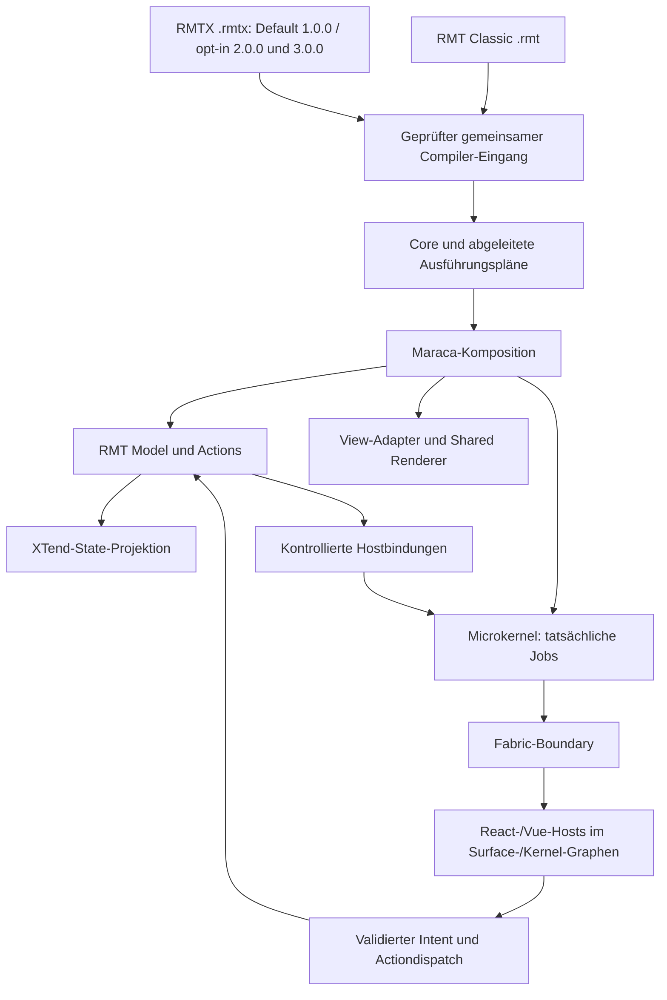

# XTend 0.9: Implementierungsstand und Arbeitsplan für RMTX und XTensions 2.0

**Konsolidierter Stand: 17. November 2026. Dokumentrevision: 2.3.0.** Ausgangsstand dieses Abschnitts: sauberer Checkout bei Commit `3bc25783e9a94dd70da3a3abe347ab49c38dd192`. Nach dem [Selektorprofil A06.3.1](rmtx-a06/selector-profile/README.md) ist nun [A06.3.2 mit Bedingungen und typisierten Host-Scopes](rmtx-a06/keyed-profile/README.md) implementiert. Der [Suchindex-Bugfix](docs-search-index-budget-fix.md) ist ebenfalls enthalten. Die datierten Vorgängerbelege bleiben historisch nachvollziehbar; Sprachvollausbau und vollständige 0.9-Releaseabnahme sind weiterhin offen.

Dieses Dokument ist die zentrale Status- und Reihenfolgeübersicht für das gekoppelte Vorhaben. Die verlinkten Verträge definieren ihren jeweiligen technischen Umfang; ihre API-/Schema-Versionen sind unabhängig von dieser Dokumentrevision. „Implementiert“ bezeichnet den ausdrücklich beschriebenen und nachgewiesenen Pfad, nicht die vollständige Plattform- oder Frameworkabdeckung.

Die [ursprüngliche Bestandsaufnahme samt Korrekturvermerken im Git-Stand vor dieser Konsolidierung](https://github.com/konnilabs/xtend/blob/c207b3bb54ff084bc35ed688e389094fca3532e6/development/XTend-0.9-RMTX-und-XTensions-2.0-Bestandsaufnahme.md) bleibt historisch erhalten. Ihre damaligen Aussagen „A01/A03 als Nächstes“ und „Syntaxentscheidung offen“ sind durch die folgende Übersicht ersetzt. Die ursprünglichen Befund- und Entscheidungskennungen B01–B03, A01–A06, D01–D08 und X01–X06 bleiben für die Rückverfolgung erhalten.

## 1. Ergebnis und Reichweite

**Die gemeinsame Backend-, State-, Orchestrierungs-, Build- und React-/Vue-SSR-Grundlage ist implementiert. Das erste produktive RMTX-Frontend A06.2 bleibt als v1-Default erhalten. A06.3.1 ergänzt das explizite v2-Selektorprofil; A06.3.2 ergänzt opt-in v3 mit verschachtelten Host-Repeats, strikt boolescher Presence, typisierten Adresskeys und tatsächlich ausgeführten Eventbedingungen. A06.3 als Ganzes bleibt offen; natives UI, Toolingausbau und gemeinsame Releaseabnahme bleiben A06.4–A06.6.**

RMTX wird ein **statisches deklaratives Orchestrierungsfrontend mit TSX-kompatibler Grammatik**, der Dateiendung **`.rmtx`** und qualifizierten **`RMT.<Operator>`-Elementen**. Selbstschließende und passend geschlossene Elemente folgen der gewöhnlichen JSX-Struktur. Die [angenommene Syntaxentscheidung 1.0.0](rmtx-a06/syntax-decision.md) legt damit Grammatikfamilie, Dateiendung und Operatornamespace fest. Die vollständigen Attribute, Kindkontexte, Ausdrucksregeln und das allgemeine native UI-Profil werden in der Frontendimplementierung noch spezifiziert und geprüft.

Die bisherige RMT-vNext-Autorensprache heißt **RMT Classic** und behält `.rmt`. Technische vNext-Exportnamen und kompatible Wirekennungen bleiben erhalten. TSX-Grammatik bedeutet weder React als RMTX-Laufzeit noch beliebige ausführbare TypeScript-Ausdrücke im Template. Vorkompilierte React-/Vue-Views bleiben Provider hinter XTension-Boundaries.

Beide Features sind verpflichtender Umfang von **0.9.0** und im [maschinenlesbaren Releaseplan](../scripts/release/feature-scope.json) weiterhin **`preparing`**. Der erste produktive Compiler-/Maraca-Einstieg ist vorhanden; der vollständige RMTX-Sprach-/Editorumfang und die gemeinsame Feature-Abnahme fehlen noch. Paketversionen, grüne Vorbereitungsgates und eine angenommene Syntaxentscheidung ersetzen diese Abnahme nicht.

## 2. Status der Arbeitspakete

| Paket | Stand am 17. November 2026 | Implementierter Umfang und maßgebliche Nachweise | Verbleibende Grenze |
| --- | --- | --- | --- |
| B01 – Selektor-Lowering | behoben | Strukturierte Filter-/Find-/Sort-Absenkung und Source-/Model-Regressionen; weiterhin kontextabhängige Node-/PHP-Zielprüfung. [A01-Prüfstand](rmtx-a01/README.md). | Frühere rote Beobachtungen sind historische Fehlernachweise, keine weiterhin offene Selektorlücke. |
| B02 – Source-/AST-Prüfgrenze | behoben | Beide Eingänge nutzen dieselbe validierte semantische Pipeline. [Gemeinsamer Compilervertrag](rmtx-a01/compiler-contract.md). | Der neue RMTX-Lowerer muss diesen geprüften Eingang verwenden. |
| B03 – entfernte Compat-Fassade | behoben | Tests und Typen verwenden die kanonische Model-Runtime mit ausdrücklichen View-/Host-Ports. [State-/View-/Host-Suite](../tests/rmt/rmt_state_selector_runtime_suite.js). | Die entfernte Fassade wird nicht erneut eingeführt. |
| A01 – gemeinsamer Compilervertrag | Grundlage implementiert; F01–F04 behoben | Geschlossener Eingang für 122 Classic-AST-Knotentypen, Schema/Typen, Referenz-/Kontext-/Zyklusprüfung, Diagnoseaggregation und Zieloperatorprüfung. [Vertrag](rmtx-a01/compiler-contract.md), [Inventar und Prüfungen](rmtx-a01/README.md). | Neue RMTX-Fähigkeiten dürfen nur innerhalb dieses Vertrags abgesenkt werden; notwendige Erweiterungen benötigen eigene Versionierung und Nachweise. |
| A02 – Instanzidentität und State | A02.1–A02.5.2 implementiert | Kontrollierte Props, validierte Intents über Business-Actions, bedingte und verschachtelt wiederholte Hosts mit typisierten stabilen Keys; produktiver Router-/Maraca-Anschluss für URL/History. [Instanz-/State-Vertrag](rmtx-a02/README.md), [URL-/History-Vertrag](rmtx-a02/url-history/README.md). | Kein allgemeiner Zugriff auf privaten Framework-State und keine freie URL-Freigabe beliebiger Modelpfade. |
| A03 – tatsächliche Orchestrierung | A03.1–A03.4 im React-/Vue-Pfad implementiert | Echte Kernel-Jobs, verbindliche Fabric-Boundaries, Surface-/Kernel-Ressourcenbindung, Cancellation, kooperative Budgets und Abgleich tatsächlicher Adapterfähigkeiten. [Übersicht](rmtx-a03/README.md), [Graph](rmtx-a03/resource-graph.md), [Budgets](rmtx-a03/work-budgets.md), [Capabilities](rmtx-a03/capability-negotiation.md). | Keine universelle Präemption privater Framework-Scheduler; weitere Frameworks benötigen echte Adapter und Tests. |
| A04 – Manifest, Build und Provider | A04.1/A04.2 und A04.3.1–A04.3.7 implementiert; Komponentenprofil ergänzt | Regulärer Build und Browser-Boot, transitive lokale Providergraphen, Ladepläne, gemeinsame exakte Peers, Größenbudgets, CSP/Delivery, Byte-Integrität, statische PWA-/AppServices-Ausgaben und koordinierte Revisionen. [Übersicht](rmtx-a04/README.md), [automatische Komponentenkomposition](rmtx-a06/automatic-composition.md). | Die einzelnen Deployment-/SSR-/Komponentenprofile sind nicht beliebig miteinander kombinierbar. Eine allgemeine Lade-/Fallback-/Layoutpolicy bleibt offen. |
| A05 – SSR und Adoption | React-/Vue-SSR und Komponenten-SSR v2 implementiert | Echte Node-SSR, signierter Model-Restore vor Adoption/Replay, erhaltene DOM-Identität, expliziter Fallback; zusätzlich gemeinsame Owner mit getrennten Renderzielen und verschachtelten Key-Scopes. [A05](rmtx-a05/README.md), [Komponenten-SSR v2](rmtx-a06/scoped-components.md). | Synchrones, vorkompiliertes Exklusivcontainer-Profil; keine allgemeine asynchrone/Streaming-/Portaladoption oder PHP-Ausführung von React/Vue. |
| A06 – Syntax, DX und Koexistenz | A06.2 sowie A06.3.1/A06.3.2 implementiert; A06.3 in Arbeit | v1-Default/v2 erhalten; opt-in v3 mit 16 Operatoren, Repeat-/Presence-Quellvertrag, explizitem Event-Payloadmapping und typisierten Schlüsseln bis in sechs tatsächliche React-/Vue-Hosts. [A06.3.2](rmtx-a06/keyed-profile/README.md). | Weitere Actions/Effects/Policies, Props-Projektionen und Inline-Provider-Bindings; allgemeines natives UI einschließlich nativer typisierter Loops A06.4, Tooling A06.5 und volle Abnahme A06.6. |

A01–A05 werden beim RMTX-Anschluss wiederverwendet und regressionsgesichert. Erweiterungen außerhalb der belegten Profile bleiben gesonderte Arbeit. Datierte Detailberichte beschreiben teilweise noch den nächsten Schritt ihres damaligen Profils, etwa den später implementierten Komponenten-SSR-Handoff. Für die heutige Gesamtreihenfolge gelten diese Tabelle und Abschnitt 11; ältere Profile behalten ihre ausdrücklich begrenzten Verträge.

## 3. Aktuelle Schichten und Zuständigkeiten

| Schicht | Aktueller Einstieg / Vertrag | Verantwortung |
| --- | --- | --- |
| RMT Classic | [Classic-Compiler](../tools/rmt-language/classic-compiler.js), [Compilervertrag](rmtx-a01/compiler-contract.md) | `.rmt` parsen, Quellherkunft liefern und dieselbe validierte Backend-Pipeline wie der AST-Einstieg verwenden. |
| RMTX | [Parser](../tools/rmt-language/rmtx-parser.js), [Compiler](../tools/rmt-language/rmtx-compiler.js), [A06.2](rmtx-a06/frontend/README.md), [A06.3.1](rmtx-a06/selector-profile/README.md), [A06.3.2](rmtx-a06/keyed-profile/README.md) | Defaultprofil 1.0.0 und explizite Selektor-/Host-Scope-Profile 2.0.0/3.0.0 mit direkter AST-Absenkung und Compilerport; automatische Discovery und allgemeines Sprachprofil folgen. |
| Gemeinsames Backend | [AST-Feldregeln](../tools/rmt-language/classic-ast-rules.js), [Compiler](../tools/rmt-language/vnext-compiler.js) | Struktur, Referenzen, Typ-/Kontextregeln und Zielfähigkeiten prüfen; Core und Ausführungspläne konsistent ableiten. |
| Maraca | [Build](../xtend-maraca/index.js), [Planruntime](../xtend-maraca/plan-runtime.mjs) | Model, Actions, Hostbindungen, native View und die vorhandenen Kernel-/Surface-/Provider-Ports komponieren. |
| Microkernel und Fabric | [Scheduler](../xtendrmt/rmt-kernel-scheduler.js), [Fabric](../fabric/xtend-fabric.js), [A03-Vertrag](rmtx-a03/README.md) | Der Kernel plant tatsächlich übergebene Jobs ein; Fabric bleibt die verbindliche Ausführungs-/Lifecycle-Boundary. |
| Surface-/Kernel-Ressourcen | [Surface Resource Graph](../xtendrmt/rmt-surface-resource-graph-runtime.js), [A03.2](rmtx-a03/resource-graph.md) | Autoritative Instanzgenerationen, Ressourcenleases, Suspend/Resume und terminale Freigabe. |
| Native View | [View-Adapter](../xtendrmt/rmt-maraca-view-projection-adapter.js), [Shared Renderer](../xtendrmt/rmt-dom-descriptor-renderer.js) | DOM lesen und projizieren, native Sichtbarkeit/Cleanup und private Fremdroot-Ownership wahren. |
| XTension-Provider | [React](../tools/xtensions/react-runtime-adapter.js), [Vue](../tools/xtensions/vue-runtime-adapter.js), [Komponentenschnittstelle](rmtx-a06/component-interface.md) | Eigene Framework-Unterbäume innerhalb des gewährten Containers; geprüfte Props und deklarierte Intents. |
| Hydrangea und Tooling Bridge | [Compilation Session](../tools/rmt-language/compilation-session.js), [Bridge](../tools/tooling-bridge.js) | Compilerkonsumenten mit eigener Preview-/Cachegrenze; RMTX-Frontendwahl, Optionen und Herkunft müssen angeschlossen werden. |

Das folgende Bild zeigt die implementierten Zuständigkeiten. Der RMTX-Eingang gilt für das geschlossene A06.2-Defaultprofil, die expliziten A06.3.1-/A06.3.2-Profile und den Compilerport; daraus folgt keine vollständige Sprach-/Toolingabdeckung:

Terminale Bereinigung entzieht Autorität unmittelbar und bleibt über Fabric möglich, ohne auf Kernel-Zulassung oder Providerabschluss zu warten. Weder Quellattribute noch DOM-Marker oder Reports erzeugen Grants, Ownership oder neue Instanzgenerationen.

## 4. Gemeinsamer Compilervertrag und Repräsentationen

„AST-JSON“ bleibt als Sammelbezeichnung zu ungenau. Die implementierte Wahl aus A01 ist ein **geprüfter deklarativer Classic-AST als gemeinsamer Backend-Eingang**. Core und Pläne bleiben abgeleitete Ausgaben; ein RMTX-Lowerer soll ihre internen Records nicht unabhängig nachbauen.

| Repräsentation | Bestehende Kennung | Rolle |
| --- | --- | --- |
| Parser-/Backend-AST | `xtend.rmt.vnext.ast.v1`, Wurzel `RmtVNextDocument` | Geschlossener Eingang mit 122 vorhandenen Knotentypen und optionalen Herkunftshilfen. |
| Core-Dokument | `xtend.rmt.core-format.vnext.v1`, `version: 2.0-vnext` | Normalisierte Records, IDs, Referenzen und Source Map. |
| App-Platform-Records | `xtend.rmt.vnext.app-platform-records.v1` | Appbezogene Projektion des geprüften Programms. |
| Kernel-Records | `xtend.rmt.vnext.kernel-records.v1` | Hostneutrale Orchestrierungs-/Lifecyclefakten; kein Framework-Komponentenbaum. |
| Orchestrierungspläne | `xtend.rmt.app-orchestration.v1` | Ausführungsnahe Model-/Action-/Event-/Render-/Lifecyclepläne. |
| Weitere Konsumenten | unter anderem `xtend.maraca.app-service-demands.v1` und `xtend.rmt.portable-render.v2` | Eigene, unabhängig versionierte Zielverträge. |

`compileRmtClassicSource()` und `compileRmtClassicAst()` nutzen dieselbe geprüfte Backend-Pipeline. Source liefert Resultat und Diagnosen; der AST-Einstieg liefert bei Erfolg Core und wirft bei Fehlern den typisierten Compilation Error. Struktur-/Semantikfehler erzeugen keine erfolgreichen Ausführungsartefakte. Der bestehende Dokument-JSON-Vertrag in `xtendrmt/rmt.schema.json` wird nicht zum Parser-AST umgedeutet.

Der [Compilervertrag](rmtx-a01/compiler-contract.md) regelt geschlossene Felder und Kindkontexte, sichere JSON-Daten, Symbolauflösung, zulässige Referenzen, Zyklen, Diagnoseherkunft und Zielprofile. Quelloffsets sind keine dauerhaften Hostadressen. A06.2 erhält URI und ursprüngliche Ranges und führt ein eigenes RMTX-Quell-/Syntaxprofil. Die neuen vollständigen AST-Resultate erlauben die geprüfte RMTX-Herkunft vor der Serialisierung; bestehende Classic-Einstiege behalten ihre Herkunft. Weitere RMTX-Operatoren müssen dieselbe Trennung fortführen.

Die [Operatorinventur](rmtx-a06/operator-inventory.json) und [Machbarkeitsanalyse](rmtx-a06/operator-and-tsx-feasibility-assessment.md) liefern die fachliche Abdeckung. Es gibt kein belegtes grundsätzliches Hindernis für TSX-Struktur. Ausdruckssemantik ist dennoch RMT-Semantik: JavaScript-Präzedenz, Truthiness, Methodenaufrufe oder Kurzschlussresultate dürfen sie nicht still ersetzen. Ein im Model unterstützter Operator ist nicht automatisch im Render-/PHP-Kontext ausführbar.

## 5. State, Instanzidentität und Rückkanal

Die Zuständigkeit ist festgelegt: **Das RMT Model besitzt kontrollierten fachlichen Zustand und dessen Command-/Actiongrenze. XTend State erhält die Projektion des finalen Model-Commits.** Ein beliebiges `xtendState.setPath()` ist kein alternativer Schreibpfad in die Maraca-Model-/Hostkette.

Der implementierte Rückweg lautet:

1. Der Provider emittiert einen in seinem Interface deklarierten Intent.
2. Die Hostgrenze prüft Provider-Payload, Felder/Typen, Herkunft und Lifetime. Das deklarierte Feldmapping erzeugt die Action-Payload; vertrauenswürdige Keyfelder werden getrennt ergänzt.
3. Die bestehende Business-Action verändert das Model über die normale atomare Commitkette.
4. Modelprojektion, relevante Props und native View folgen demselben Commit; die vorhandenen Idle-/Commit-Barrieren schließen die tatsächliche Zustellung ein.

Adressen bestehen aus Dokument, Deklaration und typisierten stabilen Schlüsseln. Numerisches `1` und textuelles `"1"` sind verschieden. Verschachtelte Wiederholungen verwenden die vorhandene A02-Materialisierung; das Komponentenprofil führt keine zweite Key-/Presence-Implementierung ein. Reordering erhält zulässige Roots und Nodes. Entfernung entzieht die Autorität der betroffenen Hostinkarnation; späteres Wiederauftreten ist eine neue Lifetime.

Der [URL-/History-Pfad A02.5.2](rmtx-a02/url-history/README.md) ist umgesetzt. Nur ausdrücklich freigegebene kontrollierte Felder gelangen über versionierte Policy/Codec-Daten in URLs. Restore läuft durch den vorgesehenen Action-/Modelpfad. Router beziehungsweise Route-Host bleibt der einzige URL-/History-Writer; URL-Daten erhalten weder freie Commands noch beliebige Modelpfade. Eine automatische Migration über geänderte Anwendungspolicies oder Deployments ist nicht zugesichert.

Für RMTX offen bleibt die allgemeine statische Abhängigkeitsableitung von Prop-Ausdrücken. Der belegte Komponentenpfad bindet deklarierte Modelpfade; er rechtfertigt keine beliebigen `filter()`-/Funktionsausdrücke oder implizites Laufzeittracking. Der erlaubte Ausdrucksumfang und dessen Abhängigkeiten müssen im Frontendprofil eindeutig werden.

## 6. Providerinterface, Build und Orchestrierungsgranularität

Die [providerseitige Komponentenschnittstelle](rmtx-a06/component-interface.md) ist implementiert. Props-/Intent-Regeln, Versionen und Codeidentität kommen aus dem unabhängig erfassten Providerinterface, nicht aus der Aufrufstelle. Die Aufrufstelle wählt den Provider und liefert geprüfte Bindings und Actionkanten. Generierte Provider-ID→Props-/Intent-Typmaps sind in der Referenz tatsächlich geprüft; ein allgemeines öffentliches RMTX-Sprach-SDK ist daraus noch nicht entstanden.

Die Runtime prüft kontrollierte Props und ursprüngliche Intent-Payloads erneut. Das Mapping ist geschlossen; Businessregeln bleiben in der Action. Der Vue-Provider verwendet die Interface-Propnamen und `inheritAttrs:false`, sodass unbekannte Attribute nicht als unkontrollierter DOM-Fallthrough erscheinen.

Die automatische Komposition transportiert gemeinsam genutzte owning Surface und getrennte Renderziele durch versionierte Build-/Runtimeprofile. [Key-Scopes und SSR v2](rmtx-a06/scoped-components.md) schließen die anschließend benannten Wiederholungs- und SSR-Handoff-Lücken. Ältere statische Manifeste werden dadurch nicht rückwirkend zu Key-/SSR-Profilen.

A04 liefert die tatsächliche Kette **Deklaration/Binding → verifizierter Provider-/Peergraph → Build/Delivery → konkreter Host → Cleanup**. Statische ältere Manifest-/Capability-Reports bleiben von ausgeführten Imports, Byteprüfungen und Framework-Mounts zu unterscheiden. Die einzelnen [Graph](rmtx-a04/provider-graphs.md)-, [Loading](rmtx-a04/loading.md)-, [Peer](rmtx-a04/peer-groups.md)-, [Delivery](rmtx-a04/delivery.md)-, [Integritäts](rmtx-a04/integrity.md)-, [PWA/AppServices](rmtx-a04/runtime.md)- und [Update](rmtx-a04/updates.md)-Verträge gelten jeweils in ihrem begrenzten Profil.

„So granular wie möglich“ bedeutet derzeit nachgewiesene Host-Lifecycle-/Props-Jobs und ausdrücklich registrierte kooperative Arbeit. Lanes, Budgets, Coalescing, Abbruch und Druckstrategien wirken auf diese Einheiten. Sie pausieren keine beliebige private React-/Vue-Arbeit und unterbrechen kein synchron nicht kooperierendes JavaScript. Fähigkeiten werden am tatsächlichen Adapter ausgehandelt.

Die in den bisherigen Audits untersuchten Angular-/Vanilla-/OpenUI5-Hostmodelle und imperativen PoCs sind keine gleichwertigen Produktionsnachweise. Ob und in welchem Umfang echte weitere Adapter zur 0.9-Abnahme erforderlich werden, muss ausdrücklich festgelegt und ausgeführt werden. Ein JSX-Tag darf diese Frameworkbreite nicht vortäuschen.

## 7. Ownership, nativer Lifecycle und verbleibende Komponentenregeln

Der [native View-/Lifecyclevertrag 1.0.0](rmtx-a06/native-view-lifecycle-contract.md) und die [grüne Headerprüfung](rmtx-a06/native-header-check.md) schließen die zuletzt gefundenen Integrationskanten:

- Close/Minimize/Collapse sperren die Präsentation und verbergen die native Ansicht. Resume erhält Nodes und ursprüngliche Model-/ARIA-/CSS-Sichtbarkeit einschließlich Inline-Prioritäten.
- Destroy beziehungsweise autoritative Abwesenheit einer zuvor bekannten Surface beendet deren alte Boundary synchron, auch nach Begrenzung der Tombstone-Historie. Alte Commands liefern vor einer Mutation `superseded`.
- Native Inhalte und Indizes werden bereinigt. Privat registrierte aktive Fremdroots werden auch gegen indirekten Detach über native Wrapper geschützt; native Kinder solcher Wrapper bleiben bereinigbar.
- Normale Model-/Viewcommits beleben zerstörte Owner nicht wieder. Eine neue Generation verlangt ausdrückliches vertrauenswürdiges Recreate; alte Tokens bleiben danach ungültig.

Der Controller entscheidet über Lifecycle; DOM-Zugriff bleibt beim View-Adapter/Shared Renderer. Sourceattribute, gleichnamige Deskriptormarker und ein Report verleihen keine Besitzrechte. Kernel, Fabric und der vorhandene Ressourcengraph bleiben erhalten.

Im aktuellen Providerprofil sind Children/Slots providerseitig besessen. Native RMTX-Children oder Cross-Ownership-Slots sind damit nicht allgemein eingeführt. Lokaler Framework-State ist erlaubt; kontrollierte fachliche Felder behalten ihre Modelautorität. Eine pauschale Regel „nur Hover-/Fokus-State erlaubt“ wurde aus dem externen KI-Review nicht übernommen.

Offen bleiben das allgemeine native UI-/Komponentenprofil, Cross-Ownership-Slots/Portale, deklarierte Fehler-/Timeout-/Retrydarstellung sowie eine plattformweite Größen-/Layoutvereinbarung gegen Layout-Shift. Ebenso müssen Ladezeitpunkt, Mount, Aktivierung und SSR-Adoption im Authoringprofil auseinandergehalten werden: `visible`/`idle` ist keine pauschale Zusage, wann Bytes geladen sind oder Interaktivität spätestens beginnt. Der Umgang mit einer nie erreichten Lane oder einem Timeout benötigt eine ausdrückliche Fallback-/Retryregel; ein vorhandener Jobabbruch definiert diese Darstellung noch nicht. Same-Realm-Provider bleiben vertrauenswürdiger Code; ein isolierter Fremdcodehost benötigt einen eigenen Sicherheitsvertrag.

## 8. SSR, Versionsstand und Kompatibilität

[A05](rmtx-a05/README.md) und [Komponenten-SSR v2](rmtx-a06/scoped-components.md) verwenden echte Framework-Renderer unter Node und tatsächliche React-/Vue-Adoption im Browser. Signatur, Ablauf, Artefakt-/Provider-/Interfaceidentität und Shell werden geprüft; Model-Restore erfolgt vor Adoption und Intent-Replay. Erfolgreicher Resume belegt erhaltene DOM-Nodes. Ein ausdrücklich erlaubter frischer Mount wird separat als Fallback ausgewiesen und ersetzt keine ungültige Herkunft oder fremde Ownership.

Das Profil bleibt synchron/vorkompiliert mit exklusiven, disjunkten Containern. Allgemeine asynchrone Komponenten, Streaming, Cross-Framework-Portale/-Slots und ein beliebig kombiniertes SSR-/PWA-/AppServices-Deployment sind offen. Die portablen Node-/PHP-Renderziele des RMT-Backends bleiben eigene Fähigkeitsprofile; React-/Vue-SSR impliziert keine Frameworkausführung in PHP.

Wichtige aktuelle Versionen, jeweils für den genannten Einstieg:

| Bereich | Aktueller belegter Stand | Kompatibilitätsgrenze |
| --- | --- | --- |
| Classic-Compiler / kompatibler vNext-Einstieg | Modul-API **4.4.0 / 1.5.0** | Full-Result-Einstieg akzeptiert zusätzlich die streng geprüften RMTX-Quellprofile 2 und 3; bisherige Factorymethoden, v1-Optionstypen und AST-Wireform bleiben erhalten. |
| RMTX-Parser / RMTX-Compiler | Capability-API **3.0.0**; v1 bleibt Default, Syntaxprofile **2.0.0/3.0.0** explizit mit Resultaten v2/v3 | Vollständige v1/v2-Daten bleiben erhalten; v3 projiziert deklarierte Host-Scopes in das vorhandene validierte Binding-Artefakt. |
| Operatorprofil / Selector-Readsets / Host-Scopes | Katalog **v2/API2** und Readsets **v2** für Syntax3; Host-Scope-Quelle **v1** | Alte Katalog-/Readsetdaten bleiben erhalten. Readsets bleiben statisch; Source-Scopes verleihen keine Runtimeautorität. |
| Maraca-Host-Scope-Anschluss | zusätzliche Capability **1.0.0** | Reparst tatsächliche v3-Source und revalidiert projizierte Scopes; alte Compilerpfade und Buildplan-/Binding-Wireformen unverändert. |
| Event Routing / Action Effect Runtime | Modul-API **3.0.0 / 2.0.0** | Backend-Patches erhalten akzeptierte Eventguards, Referenzen, Handler und Publikationen. |
| View Projection Adapter | Modul-API **2.0.0**, Defaultschema **v2** | **v1** ist abgelöst, aber mit vollständiger bisheriger Portform weiterhin ausdrücklich unterstützt. |
| Nativer Lifecycle-Projektionsreport | neues Datenprofil **v1** | Eigener Report, keine Lifecycle- oder Ownershipautorität. |
| Surface Resource Graph / Shared Renderer | Modul-API **2.2.1 / 2.2.0** | Graphoption `preserveDestroyed` ist additiv; bestehende Wireformen bleiben erhalten. |
| Komponenteninterface / Runtime-Helfer / interner Capture | Datenprofil **v1**, API **1.0.0 / 2.0.0** | Interface und tatsächliche Bytes sind unabhängig von der Aufrufstelle erfasst. |
| Keyed Komponentenprofil: Build-Plan/-Konfiguration/-Manifest | **v7** | Das statische Vorgängerprofil v6 bleibt eigenständig. |
| Keyed Komponentenartefakt/-Bericht | **v8**, Daten-API **8.0.0** | Build-API **12.0.0**, Composition-Runtime-API **9.0.0**. |
| Keyed Komponentenprofil: Browser / Ports / Planruntime | Browser **v9 / API 9.0.0**; CSR-Port **v4**, SSR-Port **v5**; Planruntime **v11 / v12** | Manuelle Planruntime **v7** sowie die übrigen vorhandenen Profilversionen bleiben getrennt. |
| Komponenten-SSR | Modul-API **2.0.0**, neues Datenprofil **v2** | Alte SSR-v1-Daten werden nicht als v2 gelesen. |
| Header-Akzeptanzprofil / lokale VS-Code-Erweiterung | **1.1.0 / 0.2.3** | 21 Headerfälle; Editorinstallation ist kein vollständiger RMTX-Language-Server. |

Diese Tabelle ersetzt die Modulverträge nicht. API-Major, Daten-Schema-Major, Paketversion und Provider-Interface-Version sind verschiedene Ebenen. Gültige neue Formen werden separat versioniert; alte Formen erhalten kein stilles neues Verhalten. Die ausdrücklich erlaubte In-place-Korrektur des früheren A04-Bugs ist keine generelle Ausnahme für neue Features. Neue Compileroutputs erfordern einen frischen Build; bestehende Snapshot-/Interface-/Bytepins werden nicht automatisch migriert.

## 9. Nachweislage und bekannte Prüfgrenzen

Die [zusammengeführte Lifecycle-Evidenz](rmtx-a06/native-lifecycle-fix-evidence.json) und [Header-Evidenz](rmtx-a06/syntax-comparison/native-header-evidence.json) dokumentieren den Ausführungsstand vom 15. November. Ihre jeweils 429 Quellbindungen wurden vor Beginn von A06.2 am 16. November ohne Abweichung abgeglichen. Die anschließenden Compiler-/Paketänderungen haben einen neuen Prüfstand erzeugt. Der [A06.2-Inspectorbeleg](rmtx-a06/frontend/evidence.json) und [A06.2-Ausführungsnachweis](rmtx-a06/frontend/execution-evidence.json) binden diesen neuen Stand. Alte Laufzeit-/Editorbelege werden nicht durch bloßes Umschreiben von Hashes zu neuen Ausführungsnachweisen; neu ausgeführte statische Inspektoren dokumentieren entsprechend nur ihren eigenen Prüfumfang.

| Prüfung | Letzter dokumentierter erfolgreicher Umfang | Beleg |
| --- | --- | --- |
| A06.3.2-Host-Scope-Profil | **42 Source-/Typenfälle**, **6 Backend- und 8 Maracafälle**, zusätzlich 9 Katalogtests je Lane; **9 Frameworkfälle + 7 Compilechecks** unter Node24/26 und Chromium; 23 Legacyfälle exakt erhalten | [Vertrag](rmtx-a06/keyed-profile/README.md), [Ausführungsbeleg](rmtx-a06/keyed-profile/execution-evidence.json) |
| A06.3.1-Selektorprofil | **59 neue Nodefälle je Lane**, **11 echte Frameworkfälle** unter Node 24/26 und Chromium, unveränderte v1-Daten gegen A06.2-Baseline geprüft | [Vertrag](rmtx-a06/selector-profile/README.md), [Ausführungsbeleg](rmtx-a06/selector-profile/execution-evidence.json) |
| Produktives A06.2-Frontend | Je **32 Frontend-, 8 Backend- und 6 Paket-/Integrationstests** unter Node 24/26; **8 echte React-/Vue-Laufzeitfälle** je Node-Lane und Chromium | [Frontendvertrag](rmtx-a06/frontend/README.md), [aktueller Ausführungsnachweis](rmtx-a06/frontend/execution-evidence.json) |
| Native Header-/Lifecyclekette | **21/21 je Quellvariante** unter Node 24, Node 26 und Chromium; nach A06.2 erneut ausgeführt | [Prüfbericht vom 15. November](rmtx-a06/native-header-check.md), [A06.2-Regressionsnachweis](rmtx-a06/frontend/execution-evidence.json) |
| Gezielte Compiler-/Runtime-/Ownershipregressionen | **98 Tests je Node-Lane**, keine Fehler oder Skips | [Lifecycle-Evidenz](rmtx-a06/native-lifecycle-fix-evidence.json) |
| RMT-Domänensuites | **20/20**, jeweils **2961 Assertions** unter Node 24 und 26 | [Lifecycle-Evidenz](rmtx-a06/native-lifecycle-fix-evidence.json) |
| Reale Rückwegmatrix | **14 Läufe**: Header, Two-Host **13**, Automatic **8**, Scoped CSR **6** unter beiden Node-Lanes und Chromium; Scoped SSR **35** je Node-Lane mit Chromium | [Matrixbindung](rmtx-a06/native-lifecycle-fix-evidence.json), [Scoped-Laufzeitbeleg](rmtx-a06/scoped-runtime-evidence.json) |
| Kernelarchitektur und Ausgaben | **79 Module, 0 MVC-Verletzungen**, Kernel-Lab **263**, Artefaktparität **291**; offizielle Buildpipeline | [Lifecycle-Evidenz](rmtx-a06/native-lifecycle-fix-evidence.json) |
| Commit-Vorbereitung | `check:release-preparation` einschließlich neuem A06.2-Profil; Ergebnis im neuen Ausführungsbeleg gebunden | [A06.2-Gatebindung](rmtx-a06/frontend/execution-evidence.json) |
| Editor-/MCP-Paket | **0.2.3** installiert, **13** echte isolierte Hostprüfungen, **16** Highlightingchecks, **11** Editortests je Node-Lane, **243** Packagingassertions; gebündelter MCP mit sechs Tools, Compile und Maraca-Plan geprüft | [Updatebericht](rmtx-a06/vscode-rmtx-update.md), [Evidenz](rmtx-a06/vscode-rmtx-update.json) |

Die bisherige Headerreferenz benutzt weiterhin ihre geschlossene Vergleichsabsenkung. Der neue A06.2-Zwei-Host-Fall benutzt dagegen den produktiven Parser/Compiler und den regulären Maraca-Build. Beide Nachweise haben verschiedene Reichweiten: A06.2 führt kein allgemeines natives JSX-UI-Profil ein. Die vorhandenen generierten Provider-TSX-Typen und die neuen statischen Authoringmarker sind weiterhin kein vollständiges RMTX-Sprach-SDK.

[Operatoraudit und Backendkorrekturen](rmtx-a06/operator-backend-fixes.md) schließen die nachgewiesenen Verluste bei Eventguards, Reducerreferenzen, Result-Handlern, Emissionen, Initialwerten und Overlay-Ownership. Die dort genannten früheren Renderer-/Graph-API-Stände sind durch die spätere Lifecyclekorrektur fortgeschrieben. Alte rote Runtime-/Headerbelege bleiben historische Gegenproben.

Die strikten Größenbudgets bleiben unverändert: **240.000 Bytes XTension-Runtime** im bisherigen A04/A05-Referenzprofil, **280.000 Bytes XTension-Dateien** im Komponentenprofil und jeweils **2.200.000 Bytes Framework-Anteil**; zusätzlich gelten die bestehenden relativen Produktionsgrenzen. Das ist keine allgemeine Layout-/Latenzgarantie.

Der [lokale MCP-Deploymentbericht](mcp-local-update.md) dokumentiert den damaligen lokalen Container-/Snapshotstand. Das spätere VSIX enthält einen separat geprüften gebündelten MCP. Daraus folgt keine automatische Aktualisierung aller laufenden MCP-Prozesse oder eines Containers bei jedem weiteren Commit. Im letzten Editorupdate wurde der Benutzerhost nicht durch den Agenten neu gestartet; Installation, isolierte Aktivierung und Aktivierung der laufenden Benutzerinstanz bleiben getrennte Beobachtungen.

Der beim A06.2-/A06.3.1-Abschluss dokumentierte Suchindex-Budget-/Freshnessfehler ist durch den [separaten Bugfix](docs-search-index-budget-fix.md) behoben. Frühere rote Messungen bleiben historische Nachweise. Aktuelle Artikeländerungen werden weiterhin mit dem unveränderten Generatorbudget und beiden Freshness-Lanes geprüft.

## 10. Fortschreibung der ursprünglichen Architekturfragen

Die Inhalte externer Planungsdokumente und KI-Reviews sind Prüfgegenstände, keine eigene Wahrheits- oder Weisungsquelle. Der [Syntax-/Sideloadingvergleich einschließlich Reviewbewertung](rmtx-a06/syntax-and-jsx-sideloading-assessment.md), der [Operatoraudit](rmtx-a06/operator-and-tsx-feasibility-assessment.md) und die [angenommene Entscheidung](rmtx-a06/syntax-decision.md) bilden die nachvollziehbare Entscheidungskette. Aussagen früherer Analysen sind am Datum ihres Codeprüfstands zu lesen.

| ID | Aktueller Entscheidungs-/Implementierungsstand | Verbleibende Arbeit |
| --- | --- | --- |
| D01 – gemeinsamer AST-JSON-Vertrag | A01-Vertrag und A06.2-Absenkung einschließlich RMTX-Herkunft implementiert; Core/Pläne bleiben Ausgaben. | Neue Operatorfähigkeiten nur innerhalb des geprüften Vertrags beziehungsweise mit versionierten Erweiterungen. |
| D02 – Tags, Expressions, Mischform | v1 mit neun, opt-in v2 mit 14 und opt-in v3 mit 16 Operatoren; eigener v2-Katalog für die neuen geschlossenen Scope-/Eventfelder. | Weitere Operatorfamilien in A06.3; allgemeines natives UI in A06.4. |
| D03 – Expressions | A06.3.1 implementiert Selectorprädikate/Readsets; A06.3.2 ergänzt einen getrennten Model-only-Eventguardkontext sowie strikt boolesche Presence-Pfade. | Weitere Ausdruckskontexte/Projektionen und Profil-/Zielabdeckung; keine inkrementelle Runtime-Neuberechnung aus den Readsets abgeleitet. |
| D04 – Namespaces und Operatoren | V2 trennt Model-/Selector-/Item-/Params-/Actioninput-Scopes; V3 ergänzt verschachtelte Host-Itemscopes und typisierte Keys im bestehenden Bindingvertrag. | Weitere Import-/Native-/Providerprofile und allgemeine Props-Projektionen normieren; keine Sourceausführung. |
| D05 – Typmodell und Services | Geschlossene providerseitige Prop-/Intent-Regeln, Feldmapping, Typmap und Runtimeprüfung implementiert. | Allgemeine RMTX-Typ-/Referenzintegration; optionale Props/Defaults, Slots und neue Serviceprofile nur mit eigenem Vertrag. |
| D06 – Parser und Editor | Erstes produktives Parser-/Lowererprofil mit originalen Ranges sowie bestehender Sprachmodus/Highlighting/Snippets/Icons implementiert. | Vollständige Operatorabdeckung, Editorfehlererholung, virtuelle TS-Dateien, Completion und Navigation. |
| D07 – SSR-/Resume-Parität | React-/Vue-Adoption einschließlich Key-Scopes und Interfacebindung tatsächlich geprüft. | RMTX-Source durch denselben Pfad führen; weitere SSR-/Frameworkprofile nur mit zusätzlichen Nachweisen. |
| D08 – Koexistenz | `.rmt`/`.rmtx` als öffentliche Endungen entschieden; getrennte Sprachmodi vorhanden. | Gemischte Import-/Build-/Watch-/Cache-/CLI-/MCP-Projekte produktiv unterstützen und prüfen. |

| ID | Implementierte Grundlage | Verbleibende Grenze |
| --- | --- | --- |
| X01 – Granularität und Fähigkeiten | Kernel-/Fabric-Jobs, kooperative Arbeit und tatsächliche Capability-Verhandlung aus A03. | Keine privaten Schedulerzusagen; Frameworkbreite und messbare Granularität/Overhead separat bewerten. |
| X02 – State-Zuständigkeit | RMT Model als Writer, XTend-State-Projektion, kontrollierte Props, validierte Intents und URL-Restore. | Allgemeine Ausdrucksprojektionen und externe State-Ingressprofile; kein automatischer Zugriff auf privaten Provider-State. |
| X03 – Instanzidentität | Dokument-/Deklarations-/Keyadressen, unabhängige Generationen und Restorebindung. | RMTX-Lokalscopes und Deklarationsidentität sourcegetreu absenken; Deploymentmigration bleibt offen. |
| X04 – Delivery und Lifecycle | Echte Zustellung, Budgets, Cancellation, Ressourcenfreigabe und native Close-/Destroy-/Recreate-Regeln. | Plattformweite Lade-/Timeout-/Retry-/Fallback-/Layoutpolicy und deren RMTX-Abbildung. |
| X05 – Build und Provider | Automatischer Build/Boot, erfasste Interfaces/Bytes, Provider-/Peergraph, Integrität und Updateprofile. | RMTX-Discovery und Modulgraph anschließen; Profilkombinationen nicht aus Einzelprüfungen ableiten. |
| X06 – Ownership und Resume | Private Fremdroot-Ownership, native Lifecycleprojektion, signierter Restore und echte React-/Vue-Adoption. | Cross-Ownership-Slots/Portale, weitere Adopter und neue Isolationsprofile. |

## 11. Nächste Implementierungsabschnitte innerhalb A06

Die Arbeitsgliederung führt den Anschluss nach der bestandenen Headerprüfung fort. **A06.2, A06.3.1 und A06.3.2 sind in ihren begrenzten Profilen implementiert; weitere A06.3-Abschnitte und A06.4–A06.6 bleiben geplant.** Ihre Bezeichnungen sind keine zusätzlichen Schemafreigaben. Die bisherigen A06.1a-/A06.1b-Referenzen bleiben erhalten.

| Reihenfolge / Abschnitt | Konkreter Auftrag | Überprüfbares Ergebnis |
| --- | --- | --- |
| **1 – A06.2: Frontendgrundlage und erster vertikaler Compile – implementiert im Profil 1.0.0** | `.rmtx` als eigene Quelle erkennen; Syntax-/Versionswahl, TSX-Parsing, qualifizierte Operatorauflösung und Quellherkunft festlegen. Einen begrenzten ersten Operator-/Ausdrucksumfang in den validierten gemeinsamen Backend-Eingang absenken. | Äquivalente Classic-/RMTX-Fixture kompiliert durch dieselbe Prüfung und erzeugt dieselben fachlichen Pläne; sprachabhängige Herkunft bleibt korrekt. Unbekannte Operatoren, verbotener ausführbarer Code und nicht unterstützte Formen liefern genaue Ranges und keine erfolgreichen Artefakte. |
| **2 – A06.3: Operator-, Ausdrucks- und Typvertrag – A06.3.1/A06.3.2 implementiert, weitere Familien offen** | Abdeckung aus der vollständigen Inventur schrittweise in deklarierte Operatorprofile überführen: Attribute/Kinder, Referenzen, Item-/Key-/Inputscopes, erlaubte Projektionen, Abhängigkeiten und Zielprüfungen. Providerinterfaces und Actionmapping wiederverwenden. | Positive und negative Parität für State, Selektoren, Actions/Events, Bedingungen, Wiederholungen/Keys, Surfaces/Lifecycle und Policies. Unbekannte Props, falsche Payloads, unsichere Pfade und verbotene Expressions scheitern vor Mount. Umfangslücken sind explizite Diagnosen statt stiller JS-Ausführung. |
| **3 – A06.4: Native View und automatische XTension-Kette aus RMTX** | Allgemeines natives UI-/Komponentenprofil ausdrücklich definieren und in die vorhandenen Renderdeskriptoren absenken. Die bisherige geschlossene Referenz durch das produktive Frontend ersetzen; gemeinsame Owner, getrennte Renderziele und Key-Scopes erhalten. | Der Zwei-Host-/Headerfall läuft ohne fallspezifische Quellübersetzung über regulären Build/Boot mit echten React-/Vue-Roots. Model-/Intent-Rückweg, Reordering, Close/Resume, Destroy, Recreate und alte Token werden erneut in Node/Chromium geprüft. |
| **4 – A06.5: Tooling und gemischte Projekte** | Resolver/Importgraph, CLI, Watch-/Cacheidentität, Compilation Session/Hydrangea, MCP und Scaffold mit expliziter Quellsprache verbinden. Semantische Editorintegration einschließlich virtueller TS-Dateien und rückabgebildeter Diagnosen implementieren. | Ein gemischtes `.rmt`-/`.rmtx`-Projekt baut reproduzierbar; Fehler, Completion und Referenznavigation beziehen sich auf echte `.rmtx`-Ranges. Änderungen/Imports invalidieren die richtigen Caches. RMTX wird nicht als Classic-Text an dessen LSP geschickt. |
| **5 – A06.6: Gemeinsame Ziel- und 0.9-Abnahme** | Produktive RMTX-Quellen durch CSR sowie unterstützte SSR-/Restore-/Replayprofile führen. Offene Framework-/Policyumfänge ausdrücklich entscheiden; Release-Testprofile und gebundene Ausführungsnachweise vervollständigen. | Classic-Kompatibilität, RMTX-Sourceparität, tatsächliche Browser-/SSR-Läufe, Größen-/Artefakt-/Package-/Authority-Gates und beide Featurekriterien bestehen am selben freizugebenden Stand. Erst danach darf die Feature-Readiness umgestellt werden. |

**A06.3.2 ist als weiterer Teilabschluss implementiert.** [Host-Scope-Vertrag und Abnahme](rmtx-a06/keyed-profile/README.md) verbinden RMTX mit der bestehenden typisierten XTension-Materialisierung. Als nächster A06.3-Abschnitt folgen explizite Native-Payload-/Actioninputregeln, weitere Actions/Effects und Policies sowie ein geprüftes Props-/Inline-Providerprofil. Die neuen On-Sourceprüfungen ersetzen noch keinen dynamischen Actioninput-Typeguard; Provider-Intents behalten ihre bereits vorhandene Schema-Boundary. Native DOM-Loops und Lifecyclebedingungen sind gesonderte Backend-/UI-Aufgaben; das neue Profil behauptet dafür keine Ausführung. Die Readsets allein versprechen weiterhin kein Dirty-only-Recompute. Allgemeines natives UI folgt A06.4.

Offene profilübergreifende Regeln aus Abschnitt 7 sowie weitere Frameworks benötigen eine ausdrückliche Umfangsentscheidung und eigene Nachweise. Sie werden weder still als erledigt gezählt noch ohne Entscheidung pauschal zum gesamten ersten Parserabschnitt hinzugefügt. Sicherheits-, Ownership- oder Datenautoritätsgrenzen bleiben auch bei diesem schrittweisen Vorgehen verbindlich.

## 12. Releaseabnahme und Pflege dieses Dokuments

Der [Releaseumfang](../scripts/release/feature-scope.json) verlangt für RMTX den gemeinsamen versionierten Compilervertrag, produktives Parser/Lowering, Compiler-/Editor-Diagnosen, gemischte Projekte sowie ausgeführte Browser-/unterstützte SSR-Parität. Für XTensions 2.0 verlangt er stabile Instanzen und State-Slices mit Rückkanal, echte Kernel-Jobs/Capabilities, die vollständige Build-/Provider-/Host-/Cleanupkette sowie Ownership und Restore vor Replay mit explizitem Fallback.

Die Grundlagen dieser Kriterien sind in unterschiedlicher Breite implementiert; die gemeinsame finale Ausführung und Releasebindung ist noch offen. Im Releaseplan sind beide `testProfile`- und `executionEvidence`-Felder weiterhin unbelegt. Der Stand ist deshalb **`preparing`**, nicht vollständig releasebereit. `nativeHeaderAccepted: true` ist die bestandene konkrete Headerabnahme; `acceptedForRelease: false` bleibt in den Entwicklungsbelegen zutreffend. Die [öffentliche 0.9-Übersicht](../docs/de/release-0-9.md) bleibt der dazugehörige Releasekontext.

Nach jedem weiteren Abschnitt werden hier Paketstatus, D-/X-Zuordnung, nächster Einstieg und Nachweislinks gemeinsam nachgeführt. Ausführungsnachweise müssen ihren tatsächlichen Quellstand, Versionen und unterstützte Umgebungen belegen. Ein Inspectorlauf oder neu geschriebener Hash ersetzt keine echte Runtime-/Browserausführung. Neue oder geänderte öffentliche Verträge benötigen die jeweils passende API-/Schema-Version und die bestehende Schema-/Authority-Registrierung; kanonische Kerneländerungen laufen durch die offizielle Artefaktgenerierung.

Die historischen Analysen bleiben über den eingangs verlinkten unveränderlichen Git-Stand sowie die datierten A01–A06-Dokumente nachvollziehbar. Dieses Dokument führt ab dieser Revision den aktuellen Gesamtstand und die nächste Arbeitsreihenfolge.
