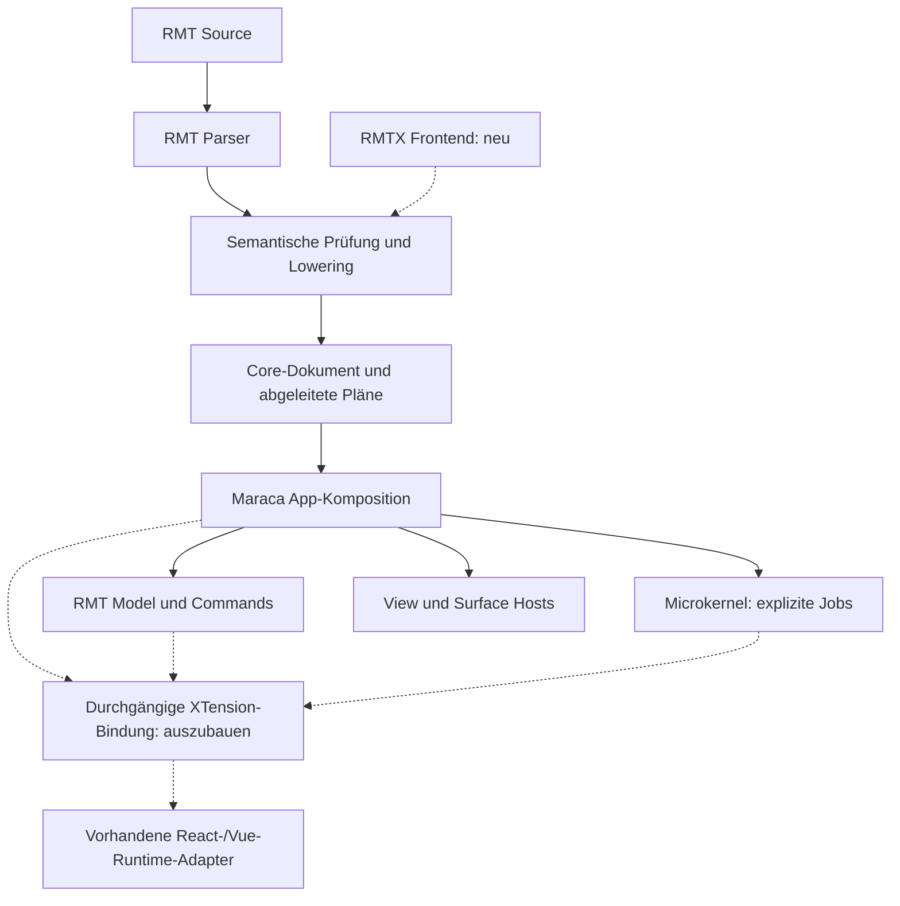

# XTend 0.9: Bestandsaufnahme für RMTX und XTensions 2.0

Stand: **5. November 2026**. Untersucht: lokaler Checkout `main`, Commit `16902dc4ea9b7563b205147fc22af47c71bf6126`. Die Paketmanifeste nennen bereits `0.9.0`; daraus folgt keine Aussage über Release-Reife. Der Checkout war vor der Untersuchung unverändert.

Planungsgrundlage: [RMTX – Konzept für die Einführung einer integrierten Template-Syntax in RMT](</home/konni/Downloads/RMTX_ Konzept für die Einführung einer integrierten Template-Syntax in RMT.md>), Arbeitsstand 4. November 2026. Das Konzept wird als Entwurf ausgewertet; seine Syntaxbeispiele, Checklisten und eingebetteten Gesprächsprompts sind keine beschlossenen Implementierungsvorgaben.

**Nachtrag vom 7. November 2026:** B01 ist im lokalen Arbeitsstand auf Basis von Commit `08c2e4be` korrigiert. Die folgenden Abschnitte bleiben die historische Bestandsaufnahme vom 5. November; Umsetzung und neue Prüfergebnisse stehen im [Korrekturvermerk](#korrekturvermerk-vom-7-november-2026-b01).

**Weitere Prüfungsrunde am 7. November 2026:** Auch B02 und B03 sind auf Basis von Commit `5d7a295c` korrigiert. Die [Fortschreibung und aktuelle Reihenfolge](#fortschreibung-vom-7-november-2026-b02-und-b03) trennt die behobenen Defekte von den noch offenen Architektur- und Integrationsfragen.

**A01 gestartet am 7. November 2026:** Eine [reproduzierbare Strukturinventur mit Abdeckungsmatrix](rmtx-a01/README.md) erfasst AST, Core, Artefakte, Operatoren und Auswerter. Vier zusätzliche Inkonsistenzen sind isoliert dokumentiert. Ein gemeinsamer normativer Frontend-/Backend-Vertrag ist damit noch nicht abgeschlossen.

**A01 fortgesetzt am 7. November 2026:** F01 (nicht ausführbare Selektorquellen) und F02 (kollidierende Core-Identitäten) sind im Arbeitsstand korrigiert und mit Source-/AST-Regressionen abgesichert. Der [implementierte Teilvertrag](rmtx-a01/identity-and-selector-sources.md) hält Ablehnungsregeln und verbleibende Grenzen fest.

**Weitere A01-Korrekturen am 7. November 2026:** Auch F03 (Diagnosekanäle) und F04 (Zieloperatoren) sind im Arbeitsstand korrigiert. Der [ergänzende Teilvertrag](rmtx-a01/diagnostics-and-render-capabilities.md) beschreibt vollständige Compiler-/LSP-Diagnosen und die geprüften Render-/Model-/Regelprofile für Node und PHP.

## 1. Ergebnis und Reichweite

**RMTX und XTensions 2.0 können auf einer erheblichen vorhandenen Infrastruktur aufbauen. Der wichtigste gemeinsame Arbeitsgegenstand ist ein geprüfter semantischer Vertrag zwischen Autorensprache, Compiler, App-Orchestrierung und Framework-Hosts.** Nur einen JSX-Parser anzuschließen würde die entscheidenden Integrationslücken nicht schließen.

Die zentralen Befunde:

1. **Ein gemeinsamer Backend-Pfad ist plausibel, aber noch keine fertige öffentliche Compiler-Schnittstelle.** RMT besitzt Parser-AST, semantischen Graphen, Core-Dokument, App-Platform-/Kernel-Records und daraus abgeleitete Ausführungspläne. „AST-JSON“ bezeichnet diese unterschiedlichen Artefakte bislang zu ungenau. Der exportierte AST-Einstieg überspringt wesentliche Prüfungen des Source-Einstiegs.
2. **Das bestehende Dokument-JSON-Schema beschreibt nicht das gesamte vNext-Compilerformat.** Eine RMTX-Inventur muss die Schemas, Parserregeln, semantischen Prüfungen, Lowering-Schritte und Runtime-Auswerter gemeinsam betrachten.
3. **XTensions haben bereits Lifecycle-, Signal-, Manifest-, Capability-, Introspection- und Resume-Verträge.** Zusätzlich existieren echte asynchrone React-/Vue-Runtime-Adapter. Gleichnamige ältere Hostadapter, Reports und PoCs sind davon zu unterscheiden. Die untersuchten Angular-/Vanilla-Hostadapter sind ausdrücklich frameworklose Implementierungen.
4. **Die vorhandene Granularität liegt überwiegend an Host- und kooperativen Ressourcengrenzen.** Ein Fabric-Lane-Eintrag erzeugt noch keinen Kernel-Job; `suspend()` hält keinen beliebigen React-/Vue-internen Scheduler an. Mehr Granularität erfordert explizite Arbeitseinheiten und nachweisbare Adapterfähigkeiten.
5. **XTend State ist im aktuellen Maraca-Pfad eine Projektion des RMT Models.** Für tief adressierbaren XTension-State fehlen eine durchgängige deklarative Bindung, der geregelte Rückkanal und eine gemeinsame Identitäts-/Versionsstrategie. URL-Deep-Links sind davon zusätzlich zu unterscheiden.
6. **Ein konkreter Source-/Runtime-Bruch ist reproduziert:** Selektor-`where` und `sort` werden als `clauses` kompiliert, vom untersuchten State-Runtime-Pfad aber nicht ausgeführt. Außerdem bricht eine vorhandene State-Testsuite wegen einer fehlenden Compat-Datei ab. Compilererfolg und gleiche JSON-Ausgabe reichen daher als Paritätskriterium nicht aus.

Dies ist eine erste Architektur- und Codebestandsaufnahme mit gezielten lokalen Prüfungen. Sie ist weder vollständiges Schema-Audit noch Security-Audit oder Freigabe für 0.9. Keine Runtime-, Compiler-, Paket- oder Syntaxänderung wurde vorgenommen. „XTensions 1.0“ bezeichnet im Folgenden den untersuchten Bestand; ein Contract-Suffix `.v1` ist keine gesondert nachgewiesene Produktversionsnummer.

## 2. Tatsächliche Schichten und Zuständigkeiten

| Schicht | Vorhandene Einstiegspunkte | Bedeutung für beide Projekte |
| --- | --- | --- |
| Älteres Dokument-/Template-Modell | [rmt.schema.json:1337](../xtendrmt/rmt.schema.json#L1337), [rmt-format.js:1](../xtendrmt/kernel/modules/rmt-format.js#L1), [format-adapter.js:1](../tools/rmt-language/format-adapter.js#L1) | Dokumente mit Templates, Adaptern, Komponenten, Routes, Schedules und Surfaces; eigener Normalisierungspfad. |
| Native RMT-vNext-Sprache | [vnext-parser.js:1](../tools/rmt-language/vnext-parser.js#L1), [semantic-graph.js:1](../tools/rmt-language/semantic-graph.js#L1) | Syntax, Quellbereiche, Deklarationen, Referenzen und kontextbezogene Diagnosen. |
| RMT-Lowering | [vnext-compiler.js:117](../tools/rmt-language/vnext-compiler.js#L117), [Source-Einstieg:5333](../tools/rmt-language/vnext-compiler.js#L5333) | Erzeugt Core-Dokument und mehrere abgeleitete Verträge. Hier liegt der wesentliche Wiederverwendungskandidat für RMTX. |
| Maraca-Build und Komposition | [index.js:2243](../xtend-maraca/index.js#L2243), [Buildplan:4406](../xtend-maraca/index.js#L4406), [browser-composition-runtime.mjs:1](../xtend-maraca/browser-composition-runtime.mjs#L1), [plan-runtime.mjs:2400](../xtend-maraca/plan-runtime.mjs#L2400) | Maraca nutzt den RMT-Compiler und komponiert Model, Actions, Ressourcen, Events, Surfaces, Renderer und Kernel. |
| Microkernel | [rmt-kernel-scheduler.js:185](../xtendrmt/rmt-kernel-scheduler.js#L185), [Scheduler-Port:1](../xtendrmt/rmt-kernel-scheduler.d.ts#L1) | Hostneutrale Jobs, Priorisierung, kooperatives Yielding, Abbruch und Host-Wartepunkte. Führt keine JSX-/Framework-Komponenten selbst aus. |
| Fabric | [runFiber:1481](../fabric/xtend-fabric.js#L1481), [createBoundary:2773](../fabric/xtend-fabric.js#L2773) | Lanes, Fiber-Records, Fehler-/Performancebeobachtung und Backpressure-Anschluss; die hier verwendete Boundary führt ihren Callback direkt aus. |
| Framework-Hosts | [runtime-host-controller.js:63](../tools/xtensions/runtime-host-controller.js#L63), [React](../tools/xtensions/react-runtime-adapter.js), [Vue](../tools/xtensions/vue-runtime-adapter.js) | Injizierte Frameworks und Komponenten bleiben außerhalb des Kernels; Host kontrolliert Container, Props, erlaubte Events und kooperative Ressourcen. |
| SSR, Seiten und Resume | [page-build.js:10](../tools/rmt-language/page-build.js#L10), [rmt-portable-render.js:1](../xtendrmt/rmt-portable-render.js#L1), [Resume-Command-Adapter:20](../xtendrmt/rmt-resume-command-adapter.js#L20) | Zusätzliche Compilerkonsumenten mit eigenen Ausführungsgrenzen; XTension-Adoption ist hostseitig injizierbar. |
| Hydrangea | [tooling-bridge.js:89](../tools/tooling-bridge.js#L89), [compilation-session.js:7](../tools/rmt-language/compilation-session.js#L7), [rmt-jit-kernel-cache.js:1](../tools/rmt-jit-kernel-cache.js#L1) | Bündelt Compile, Safe Preview und optional Maraca requestlokal; Cache für geprüfte Framework-/Kernel-Artefakte. Keine zusätzliche UI-Runtime. |

Der heutige Hauptpfad lässt sich so zusammenfassen. Die gestrichelten Verbindungen sind **vorgeschlagene Erweiterungspunkte**, kein implementierter RMTX-/XTensions-2.0-Pfad:



Die Gleichsetzung „Maraca erzeugt AST, Kernel führt AST aus“ sollte in der Planung präzisiert werden: Die Frontend-/Compilerwerkzeuge erzeugen mehrere Repräsentationen; die App-Komposition setzt deren Pläne über Services und Ports um. Der Microkernel orchestriert die ihm tatsächlich übergebenen Arbeitseinheiten.

## 3. Was heute unter „AST-JSON“ fällt

| Repräsentation | Vertrag/Shape | Einordnung |
| --- | --- | --- |
| Parser-AST | `xtend.rmt.vnext.ast.v1`, `Rmt*Declaration`-/Clause-Knoten | Syntaxnahe Baumstruktur mit Ranges, Namen und Scopes; Eingang für semantische Analyse und Lowering. |
| Core-Dokument | `xtend.rmt.core-format.vnext.v1`, `kind: rmt_document`, `version: 2.0-vnext` | Normalisierte Records mit IDs, Referenzen und `sourceMap`; kein direkt ausführbarer Framework-Baum. |
| App Platform | `xtend.rmt.vnext.app-platform-records.v1` | App-bezogene Projektion, etwa `state`, Selektoren, Actions, Surfaces und Ressourcen. |
| Kernel Records | `xtend.rmt.vnext.kernel-records.v1` | Schedules, Fibers, Lifecycle- und Referenzdaten ohne Framework-Runtime-Typen. |
| Orchestrierung | `xtend.rmt.app-orchestration.v1` | Ausführungsnahe Pläne für State, Actions, Events, Renderdeskriptoren, Hydration, Validation, Animationen und Transitions. |
| Weitere Konsumenten | u. a. `xtend.maraca.app-service-demands.v1`, `xtend.rmt.portable-render.v2`, Template-Artefakt-Bundles | Eigene Verträge und Fingerprints; Änderungen am gemeinsamen Modell müssen auch hier wirksam werden. |

Fundstellen: [Compilerkonstanten:13](../tools/rmt-language/vnext-compiler.js#L13), [App-Platform-Projektion:752](../tools/rmt-language/vnext-compiler.js#L752), [Kernel Records:1136](../tools/rmt-language/vnext-compiler.js#L1136), [Orchestrierung:4050](../tools/rmt-language/vnext-compiler.js#L4050), [Maraca-Template-Artefakte:1285](../xtend-maraca/index.js#L1285).

### Kein einzelnes Schema deckt die Semantik ab

`xtendrmt/rmt.schema.json` ist ein Draft-2020-12-Dokument-JSON-Schema mit `additionalProperties: false`. Seine Root-Properties umfassen unter anderem `templates`, `adapters`, `components`, `routes`, `schedules` und `surfaces`. Die vNext-Ausgabe enthält darüber hinaus etwa `schema`, `imports`, `states`, `selectors`, `actions`, `lanes`, `operations`, `sourceMap`, `appPlatform` und `kernelRecords`. Diese Felder sind dort keine erlaubten Root-Properties. Das ist ein Unterschied der Repräsentationen, kein Beweis, dass bestehende Dokumente ungültig sind.

Auch Typdeklarationen allein sind keine vollständige Sprachdefinition: [vnext-compiler.d.ts](../tools/rmt-language/vnext-compiler.d.ts) exportiert breite Tooling-Funktionstypen; [RmtCompileResult:174](../tools/rmt-language/rmt-tooling-public-types.d.ts#L174) verwendet standardmäßig `RmtJsonValue`. Zusätzliche Semantik steckt in Parser, Graph, Lowering, Runtime und den verteilten Entwicklungsverträgen.

### Ein vorhandener AST-Einstieg ist noch kein gemeinsames Frontend-Protokoll

`compileRmtVNextSource()` führt Parsing, primitiven semantischen Graphen, Fehlerprüfung, Lowering, AppService-Prüfungen und Orchestrierungsableitung aus. Dagegen instanziiert [compileRmtVNextAst():5298](../tools/rmt-language/vnext-compiler.js#L5298) unmittelbar den Compiler und gibt nur das Core-Dokument zurück. Der Aufruf ist daher kein gleichwertiger Ersatz für die gesamte Source-Pipeline.

**Lokal nachgewiesen:** Die vorhandene semantisch ungültige Fixture `vnext-primitives-semantic-invalid.rmt` wird syntaktisch akzeptiert und vom Source-Einstieg mit `phase: semantic` abgewiesen. Derselbe Parser-AST liefert über `compileRmtVNextAst()` trotzdem ein Core-Dokument. RMTX darf diesen Einstieg nicht ungeprüft als Produktionsbackend übernehmen.

Weitere Kopplungen: `sourceSyntax: rmt-vnext` ist in mehreren Compilerartefakten fest eingetragen; Source-Map-Einträge enthalten `nodeType`, `astPointer`, `corePointer`, `range` und ein aus der Record-ID abgeleitetes `sourceRef`. Ein frontendübergreifender Vertrag für Quell-URI, Syntaxherkunft und mehrstufiges Lowering muss ausdrücklich definiert werden. Wiederholte identische RMT-Eingaben erzeugen bereits bytegleiche Core-Ausgabe; das ersetzt keine Prüfung stabiler Identitäten über Umformatierung, Umbenennung oder zwei Autorensprachen hinweg.

**Empfehlung, noch keine Entscheidung:** Einen gemeinsamen semantischen Backend-Einstieg definieren, der validierte Frontend-Fakten einschließlich Quellherkunft übernimmt und alle nachfolgenden Artefakte konsistent erzeugt. Zunächst prüfen, ob ein sauber definierter vorhandener `Rmt*`-AST dafür genügt oder eine syntaxneutrale Zwischenrepräsentation nötig ist. RMTX direkt auf interne Core-Records schreiben zu lassen würde sonst Prüfungen und Ableitungen duplizieren.

## 4. Erste Schema- und Semantikmatrix

Die Pfade beziehen sich auf die jeweils genannte Repräsentation. Die Tabelle ist ein Startinventar für die nächste vertiefte Inventur; sie behauptet keine vollständige Operatorabdeckung.

| Bereich | Tatsächlicher Bestand und Kontext | Offener gemeinsamer Vertrag für RMTX / XTensions 2.0 |
| --- | --- | --- |
| Dokument, Imports und Namespace | Parser `RmtImportDeclaration`, Templates und Top-Level-Deklarationen; Core `/manifest`, `/imports`, `/templates`. [Import-Resolver:30](../tools/rmt-language/vnext-import-resolver.js#L30) erlaubt ausschließlich `.rmt` und definierte `.rmt`-Globs. | Gemischte Projekte, Export-/Importnamensräume, Framework-Entry gegenüber RMT-Modul, Versions- und Zyklusregeln. `.rmtx` ist eine neue Build-/Resolverentscheidung. |
| UI, Komponenten, Children und Slots | Dokument-Schema `/$defs/template`, `component`, `binding`, `slot`; vNext `/surfaces[*].component`, Slots in Operation-Policies; Orchestrierung `/render/descriptors` und `/render/root`. [createRenderDescriptor:1998](../tools/rmt-language/vnext-compiler.js#L1998) enthält komponentenbezogene Projektionen. | Generischer verschachtelter UI-Baum, Native-/XTension-Auflösung, Props und Slottypen; Render-Ownership beim Übergang in einen Fremdhost. Eine JSX-Taghierarchie lässt sich nicht automatisch eins zu eins als heutige Surface-Liste auffassen. |
| State und Models | Parser State mit `type`, `initial`, `preserve`; Core `/states`; Orchestrierung `/state/states`; Runtime Model Reader und Command Port. | Lebensdauer, Scope, serialisierbare Typen, adressierbare Teilzustände, getrennte Props und interner Fremdframework-State. Kein React-Hook-/Vue-Proxy-Objekt als Artefaktwert. |
| Selektoren und Expressions | `when` besitzt einen eigenen Ausdrucksbaum; Selektor-`where`/`find` werden zunächst als Text-Clausen erfasst. Runtime hat strukturierte Filter-, Map-, Reduce- und Transform-Records. | Einheitlicher erlaubter Ausdrucksumfang und tatsächliches Lowering in ausführbare Records. Der nachgewiesene `clauses`-Bruch muss vor einer Paritätsbehauptung bearbeitet werden. |
| Actions, Effects und Services | Core `/actions`, `/effects`, `/dataSources`; Inputs, Reducer, Emit und Service-Demands; typisierte Payload-Fakten und Input-Policies im Compiler. | XTension-Intents als deklarierte Commands/Actions; bindbare Payload-Pfade, atomare Model-Änderungen, definierte Fehler-/Abbruchantwort. Funktionen bleiben Host-Service-Implementierung. |
| Bedingungen, Iteration und Keys | `when`; Surface `repeat from` und `key`; semantische Diagnose für unkeyed Repeat. Renderer besitzt eigene Conditional-/Repeat-Deskriptoren. | Lexikalischer Item-/Index-Scope, Keytyp und Kollisionsregeln, dynamische Children, Instanzidentität und Cleanup. Ein JS-`.map()` wäre ein statisch zu prüfendes Sprachmuster. |
| Surfaces, Portals, Overlays und Ressourcen | Core `/surfaces`, `/portals`, `/overlays`, `/resources`; Referenz-/Owner-Prüfungen, Bounds, Preserve und Destroy-Releases. | Kleinste orchestrierbare XTension-Einheit, verschachtelte Hosts, Portalziele, Fokus-/Style-Besitz und Ressourcen pro Instanz. |
| Lanes und Lifecycle | Core `/lanes`, `/operations`; `mount`, `hydrate`, `suspend`, `resume`, `invalidate`, `dispose`, `prewarm`, `recycle`, `detach`, `reattach`; Kernel-Records und HostController-Lifecycle sind getrennte Verträge. | Explizite Abbildung von RMT-Operation auf Adaptermethode und Kernel-Endpoint, inklusive asynchronem Abschluss, Cancellation, Coalescing und ununterstützten Operationen. |
| Events und Governance | Core `/events`, Orchestrierung `/events`; XTension `KernelSignal` downstream, `SurfaceEvent` upstream, jeweils mit Owner-/Target-/Lane-/Policy-Fakten. | Statisch prüfbare Props-/Payload-Schemas plus tatsächliche Payloadprüfung und Zustellungsimplementierung. Kein automatisches Gleichsetzen der mehreren Eventformate. |
| FormValidation | Core `/validations`, Orchestrierung `/validation`; Feld-, Action-, Target- und Komponentenbezüge. | Validierung fremder Controls, Fehler-/Touched-/Dirty-Modell, atomare Form-State-Updates und Host-Fokus-Command. |
| Transition und Animation | Core `/transitions`, `/animations`; Orchestrierung `/transitions`, `/animationEngine`; Budgets und Reduced-Motion-Informationen. | Wer animiert welche DOM-Eigenschaft? Wie werden Animationen/Loops einer XTension pausiert, abgebrochen und freigegeben? |
| Policies und DOM-Grenzen | Core `/securityPolicies`, `/hydrationPolicies`; Orchestrierung `/security`; Hostcontainer und Adapter-Policies; keine Framework-Runtime-Typen im Kernel. | Unterscheidung von Container-/Style-Ownership, erlaubten Fähigkeiten und tatsächlicher Isolation. RMTX-Tags dürfen diese Grenzen nicht implizit erweitern. |
| SSR, Hydration und Resume | Hydration-Plan, Portable Render, Resume-Envelope mit `xtensions`, injizierte Adopter und XTension-Resume-Manifest. | Stabile Host-/Instanz-/Key-IDs, Snapshot-Versionen, Restore-Reihenfolge, Event-Replay und definierter Fallback. Vorhandene echte React-/Vue-Runtime-Adapter bieten selbst keine SSR-Adoption. |
| Diagnostik und Editor | Source Maps, symbol-/referenzbezogene Diagnosen, LSP mit Completion, Hover, Definition und References; [VS-Code-Registrierung:67](../tools/rmt-editor/vscode/package.json#L67) für `.rmt`. | RMTX-Parsing und Fehlererholung, Tag-/Prop-/Slotprüfung, Source-Mapping bis zum Host, Formatierung und Navigation zwischen beiden Sprachen. Vorhandene RMT-Editorfunktionen sind keine TSX-Unterstützung. |

### Ausdruckssemantik muss separat inventarisiert werden

[vnext-parser.js:2141](../tools/rmt-language/vnext-parser.js#L2141) erlaubt in `when` Literale, Pfade, Klammern, `!`, `&&`, `||` und `==`, `!=`, `>`, `>=`, `<`, `<=`; Funktionsaufrufe werden ausdrücklich diagnostiziert. Das ist keine allgemeine JavaScript-Auswertung.

Andere Pfade haben andere Shapes: [compileSelectorClause():627](../tools/rmt-language/vnext-compiler.js#L627) erzeugt Text-Clausen; [State-Transforms:342](../xtendrmt/rmt-state-selector-runtime.js#L342) kennen strukturierte Operatoren; [Portable Render:6](../xtendrmt/rmt-portable-render.js#L6) führt wiederum eine eigene Liste unterstützter Operatoren und Knotentypen. Node-/PHP-Zielparität ist bereits dort eingeschränkt. Aus einer Runtime-Operatorliste darf deshalb keine vollständige RMT-/RMTX-Grammatik abgeleitet werden.

Für die nächste Inventur sollte jede einzelne Operation folgende Spalten erhalten: Quellkontext, AST-Shape, Core-/Plan-Pointer, Referenz- und Typregeln, Scope, Runtime-Auswerter, unterstützte Ziele, positive und negative Fixture sowie Quellpositionsabbildung.

## 5. XTensions: vorhandene Bausteine und ihre Grenzen

### Contracts, Reports und echte Ausführung auseinanderhalten

| Baustein | Nachgewiesener Umfang | Grenze / Anschlussbedarf |
| --- | --- | --- |
| [HostController-Vertrag](../tools/xtensions/host-controller-contract.js) | `mount`, `update`, `suspend`, `resume`, `reportError`, `unmount`; Result-, Lifecycle- und Cleanup-Records. | Lifecycle-Kompatibilität allein garantiert keine Ausführung eines echten Frameworks. |
| [React-Runtime-Adapter:10](../tools/xtensions/react-runtime-adapter.js#L10) | Injizierte, versionsgeprüfte React-/ReactDOM-Peers; `createRoot`, `root.render`, Commit-Anschluss und `root.unmount`; Framework-Fehlergrenze. | Ein Root mit einer Hostkomponente. Kein Zugriff auf beliebige React-interne Work Units, kein `hydrateRoot` in diesem Adapter. |
| [Vue-Runtime-Adapter:9](../tools/xtensions/vue-runtime-adapter.js#L9) | Injizierte Vue-3-Peers; `createApp`, reaktive Props, `nextTick`, Error Handler und Unmount. | Kein allgemeiner Zugriff auf Vue-interne Scheduler; keine SSR-Adoption in diesem Adapter. |
| [Gemeinsamer Runtime-Host:63](../tools/xtensions/runtime-host-controller.js#L63) | Asynchrone Lifecycle-Queue, Single-Flight-Mount, Containerbesitz, Abbruch/Generation Guards, vollständiger Props-Ersatz und erlaubte Events. | Der anfängliche Container muss leer sein. Suspend blockiert Hostupdates und stoppt registrierte Ressourcen; eine vollständige Pause interner Framework-Arbeit wird nicht implementiert. |
| [Kooperativer Resource Scope:7](../tools/xtensions/cooperative-resource-scope.js#L7) | Hostfreigegebene Ressourcennamen, synchrone Start-/Cleanup-Factories, AbortSignal, Generation Guards und umgekehrter Cleanup. | Ressourcen müssen bewusst registriert sein. Timer oder Effects außerhalb dieser Kooperation werden dadurch nicht kontrolliert. |
| [Ältere React-/Vue-Hostadapter](../tools/xtensions/react-host-adapter.js), [PoCs](../tools/xtensions/react-host-controller-poc.js) | Synchrone Contract-/Fixture-Pfade und simulierte State-/Scheduling-Modelle neben den neuen Runtime-Factories. | PoC-Commands oder Reportfähigkeiten dürfen nicht als zugesicherte Fähigkeiten der echten Runtime-Adapter beworben werden. |
| [Angular:239](../tools/xtensions/angular-host-adapter.js#L239), [Vanilla:408](../tools/xtensions/vanilla-host-adapter.js#L408), [OpenUI5](../tools/xtensions/openui5-host-adapter.js) | Frameworklose Hosts und Boundary-/Lifecycle-Modelle; Angular-AOT-/Zoneless-Fakten, Vanilla-Container-/Shadow-/Iframe-Regeln. | Die geprüften Factories bootstrappen keine echte Angular-App und erzeugen keinen vollständigen Vanilla-/Iframe-Ausführungshost. Echte Adapter und Akzeptanztests bleiben gesonderte Arbeit. |
| [Imperative PoCs](../tools/xtensions/imperative-host-pocs.js), [Three-Loop-PoC](../tools/xtensions/three-render-loop-poc.js) | Modelle für Chart-/Leaflet-/Render-Loop-Lifecycle, Ressourcen und Scheduling-Absicht. | Keine pauschale Produktionsunterstützung sämtlicher Drittbibliotheken. |

Die echten React-/Vue-Factories werden additiv unter `@ccslabs/xtend/xtensions/*-runtime-adapter` und `@ccslabs/xtend-compiler/xtensions/*-runtime-adapter` exportiert. Sie laden Frameworks nicht selbst aus URLs. `loadRuntime({ signal })` und Peers werden vom Host gestellt. Frameworkimplementierungen werden dadurch keine Kernel-Abhängigkeiten. Der [WP1-Bericht](XTensions-Runtime-Adapters-WP1.md) beschreibt diesen Unterschied ebenfalls; seine historischen Prüfergebnisse werden hier nicht als neu ausgeführt gewertet.

### Manifest und Capability Registry sind noch kein durchgängiger Loader

[maraca-xtension-manifest.js:622](../tools/xtensions/maraca-xtension-manifest.js#L622) erzeugt Buildpläne und Bundle-Reports mit Entries, Contract-Snapshots, Lazy-Policy, Integrity, CSP, Fallbacks und Fingerprints. [runtime-capability-registry.js:701](../tools/xtensions/runtime-capability-registry.js#L701) erzeugt Ladeentscheidungen, darunter `dynamicImportAllowed`, und kennzeichnet diese mit `runtimeExecutionRequired: false`.

In den untersuchten zentralen Maraca-Build-/Kompositionspfaden wurde kein Aufruf dieser XTension-Buildplan-/Registry-Factories gefunden. Deren konkrete Nutzung liegt insbesondere in XTensions-Werkzeugen, Fixtures und Tests. Ein Reportstatus `loaded` beschreibt hier eine Policyentscheidung; er belegt keinen ausgeführten Import, keinen Byte-Integrity-Check und keinen gemounteten Framework-Host.

Für 2.0 fehlt an dieser Stelle ein durchgängiger Zusammenhang: RMT-/RMTX-Deklaration → statischer Contract → Buildgraph/Chunk → verifiziertes Host-Provider-Modul → Instanz im Container → Kernel-/Model-/Event-Anschluss → Dispose. Bestehende Remote-/XScaler- und Resume-Anschlüsse sind separat vorhanden und dürfen dabei nicht durch einen zweiten unabhängigen Loader umgangen werden.

### Signalmodell ist reichhaltiger als die echte Adapter-Update-API

[signal-bridge-contract.d.ts](../tools/xtensions/signal-bridge-contract.d.ts) beschreibt unter anderem Downstream-Target, Owner, Schema-Referenzen, Lane, TTL, Correlation-/Idempotency-Fakten, Coalescing, Rate Limits und Dead Letters. Die Report-/Normalisierungsfunktionen prüfen solche Fakten und erzeugen Diagnose-Records.

Die echte Runtime-API nimmt dagegen explizite vollständige Props-Updates an. Vue verlangt zusätzlich `applyPropsUpdate` oder `type: props.update`. `emit()` ist durch die beim Hostbau erteilte Event-Allowlist begrenzt; `validateProps` kann der Host injizieren. Ein Schema-Identifier am Event ist für sich noch kein Nachweis, dass dessen Payload gegen ein vollständiges Schema validiert wurde. Eine Transport-/Dispatch-Schicht muss die Vertragsfakten tatsächlich durchsetzen und die schmalere Adapter-API gezielt aufrufen.

## 6. Was „so granular wie möglich“ technisch bedeuten kann

| Granularität | Heutiger Nachweis | Arbeit für XTensions 2.0 |
| --- | --- | --- |
| Laden und Aktivieren eines Hosts | Lazy-/Capability-Fakten und injizierter Runtime-Provider; echte React-/Vue-Mounts. | Deklarative Build-/Loader-/Shell-Verkettung und Cancellation bis zur Instanz. |
| Lifecycle und Props je Instanz | Mount, Update, Suspend, Resume, Unmount; vollständiger Props-Ersatz. | Stabile Instanzadressen, verbindliche State-Projektion und definierter Umgang mit Updates während Suspension. Der aktuelle Adapter überspringt solche Updates. |
| Kooperative Ressourcen | Resource-Factories mit Abort-/Generation-Kontext und Cleanup. | Ausführbare Kernel-Endpoints mit Lane, Budget, Coalescing und Rückdruck für deklarierte Arbeitsklassen. Ressourcenregistrierung allein schedult deren innere Arbeit noch nicht. |
| Kleine Komponenten-/Bereichs-Hosts | Mehrere separate Hostcontroller sind grundsätzlich konstruierbar. | Regeln für verschachtelte Container, Wiederholungs-Keys, gemeinsame Runtime-Nutzung, Fehler-/State-Isolation und Overheadmessungen. |
| Framework-interne Render-/Effect-Schritte | Kein allgemeiner Steuerungspfad in den geprüften Runtime-Adaptern. | Pro Framework öffentlich unterstützte, kooperative Integrationspunkte untersuchen. Fähigkeiten ausdrücklich aushandeln; keine universelle Präemption versprechen. |

Der Microkernel besitzt bereits `schedule(request, work)`, `scope`, `rootId`, Lane, Priorität, Budget-/Chunk-Hinweise, Coalescing, AbortSignal, `shouldYield()` und `yield()`. Der geprüfte Runtime-Host ruft dagegen `fabric.createBoundary(...).run(...)` auf. Diese Boundary nutzt `runFiber()`, das den Callback unmittelbar ausführt und die Ausführung beobachtet. **Das ergibt im untersuchten Adapterpfad noch keine Einplanung in die Microkernel-Queue.**

Empfehlung: Für jede XTension deklarieren, welche Einheiten wirklich steuerbar sind, etwa Host, Props-Commit, Datenaufbereitung und registrierter Render-Loop. Nicht verfügbare Fähigkeiten müssen beim Build oder beim Capability-Abgleich sichtbar werden. Die Entscheidung über einen eigenen Kernel-Mechanismus sollte erst folgen, wenn sich eine notwendige Fähigkeit mit den bestehenden Job-/Host-Ports nicht ausdrücken lässt.

RMTX und RMT brauchen dafür dieselben Zieladressen, Lifecycle-Operationen und Capability-Fakten. Diese Semantik sollte vor einer Tag-Schreibweise feststehen. Bei wiederholten Hosts muss die Adresse aus einer stabilen Deklarationsidentität und dem fachlichen Key entstehen; Quelloffset oder Listenindex allein sind für State-Restore und Resume ungeeignet.

## 7. XTend State, Model-Zuständigkeit und „tiefverlinkend“

Zunächst sind zwei Anforderungen auseinanderzuhalten: **adressierbare verschachtelte State-Pfade** und gegebenenfalls zusätzlich **über URLs teilbarer Zustand**. Die Anfrage legt noch keinen endgültigen URL-Vertrag fest. Beide Themen haben im Bestand unterschiedliche Anknüpfungspunkte.

### Aktuelle Richtung des Datenflusses

[components/xtend-state.d.ts:120](../components/xtend-state.d.ts#L120) bietet `get`, `set`, `getPath`, `setPath`, `subscribe`, `batchUpdate`, Storage und einen RMT-State-Adapter. Die State-API ist kein automatischer Zugriff auf React-Hook-State oder Vue-Stores.

Im Maraca-App-Pfad wird das RMT Model aus dem State-Plan erzeugt. Es hat einen read-only Model Reader, einen Model Command Port für `set`/`patch`/`dispatch` und transaktionale Änderungen. [notify():696](../xtendrmt/rmt-state-selector-runtime.js#L696) projiziert den finalen Snapshot mittels `stateProjectionPort.batchUpdate(...)`. Die [Browser-Komposition:232](../xtend-maraca/browser-composition-runtime.mjs#L232) verwendet dafür standardmäßig `xtendState` als Ziel. [rmt-state-host-adapter.js:31](../xtendrmt/rmt-state-host-adapter.js#L31) passt dessen API an.

Das ergibt **RMT Model → State-Projektion**. Ein nachträgliches beliebiges `xtendState.setPath(...)` ist in diesem Pfad nicht automatisch eine Model-Mutation oder ein XTension-Props-Update. Der vorhandene Adapter bietet zwar auch `get` und `subscribe`; daraus folgt keine bereits verdrahtete bidirektionale Model-Synchronisierung. Ältere Dokumente mit „Classic State als SSOT“ dürfen diese aktuelle Model-/Command-Port-Trennung nicht verdecken.

### Vorschlag für eine gemeinsame State-Anbindung

Eine zu prüfende Flussrichtung wäre:

1. Ein externer State- oder Navigations-Intent wird validiert und über eine deklarierte Action beziehungsweise den vorgesehenen Model-Command-Pfad übernommen.
2. Der Model-Commit erzeugt State-Projektion und die für eine XTension relevanten Selektor-/Props-Fakten.
3. Ein expliziter Scheduler-/Host-Anschluss übergibt der konkreten Instanz einen konsistenten vollständigen Props-Satz.
4. Die XTension meldet einen typisierten Intent zurück; dessen Handler verändert wieder das Model und umgeht keine Command-/Transaktionsgrenze.

Falls XTend State selbst die führende externe State-Quelle werden soll, ist das eine ausdrückliche Architekturentscheidung samt Ingress-Adapter. Zwei gegenseitig spiegelnde Stores ohne festgelegte Zuständigkeit wären keine hinreichende Definition.

Noch festzulegen: Binding-Richtung je Feld, Instanz-/Namespace-Pfad, Default und Typ, interne gegenüber extern kontrollierten Werten, Revision und Herkunft, Schleifenunterdrückung, atomare Mehrfeldänderungen, Update-Coalescing sowie das Verhalten während Load, Suspend, Restore und Dispose. Wiederverwendbare Bibliothekskomponenten können dafür einen vertrauenswürdigen Host-Wrapper benötigen; allgemeine Callback-Props gehören nicht in serialisierte Artefakte.

Für URL-Deep-Links sind zusätzlich Codec/Schema-Version, erlaubte Felder, Pfad-/Query-/Hash-Abbildung, `pushState` gegenüber `replaceState`, Initial-Restore, Back/Forward und Fallback bei unbekannten Daten zu definieren. [xrouter.js:934](../components/xrouter.js#L934) und [page-client.mjs:159](../xtendrmt/page-client.mjs#L159) besitzen Navigation-/History-Anschlüsse. Im untersuchten XTensions-/State-Pfad wurde kein allgemeiner Codec gefunden, der beliebige deklarierte XTension-State-Slices automatisch damit verbindet.

## 8. SSR, Resume, Hydrangea und weitere betroffene Komponenten

| Komponente | Wiederverwendbarer Bestand | Notwendiger Abgleich |
| --- | --- | --- |
| SSR / Portable Render | Gemeinsame Renderdeskriptoren für Browser/Node/PHP, explizite Operator-/Target-Prüfung. | RMTX-Ausdrücke müssen früh auf Target-Ausführbarkeit geprüft werden. Gleiche Client-Syntax impliziert keine PHP-/SSR-Parität. |
| XTension-Resume | [resume-adapter-contract.js](../tools/xtensions/resume-adapter-contract.js): Client-/Server-Entry, Integrity, Snapshot-Schema, `dom_hydrate`/`host_activate`; [Resume-Command-Adapter:51](../xtendrmt/rmt-resume-command-adapter.js#L51) ruft injizierte Adopter auf. | Echte Framework-Adopter, Snapshot-Vertrag, Instanzzuordnung, Restore vor Replay und expliziter Hydration-Fallback. Erfolgreiches Remount darf nicht als erhaltene DOM-Identität gelten. |
| SurfaceManager / DOM-Renderer | Surface-/Ressourcenruntime, Lifecycle, Portals und Native-Shell-Anschlüsse. | Container der XTension vor fremdem Diff/Replace schützen; Zuständigkeit für Child-Slots, Fokus, Animationen und Cleanup definieren. |
| Maraca / AppServices | Buildgraph, Service-Demands, Runtime-Komposition und injizierbare Compilerfunktion. | Gemeinsamer Frontend-Dispatcher, XTension-Entries/Contracts als Buildinputs, Chunk-/Runtime-Deduplizierung und tatsächlicher Manifest-/Provider-Anschluss. |
| Hydrangea / Tooling Bridge | `jit-compile` verwendet eine Compilation Session und optional denselben Compile für Maraca; Safe Preview ist eine eigene Stufe. | Syntaxkennung und Frontendoptionen in Routing/Cacheidentität übernehmen; Compiler-/Schemaänderungen in Fingerprints aufnehmen; gemeinsame Diagnosen mit korrekten RMTX-Ranges. |
| Safe Preview | Vorschauprojektor erhält Core-Dokumente. | Für XTensions festlegen, ob nur sichere Contract-/Placeholder-Vorschau oder ein separat erlaubter Host ausgeführt wird. Keine stillschweigende Framework-Ausführung aus Tagdaten. |
| Import Resolver, LSP, Projektindex, Scaffold | `.rmt`-Resolver, Source-Modell, Navigation, bestehende Build-/App-Templates. | Dateityp-/Modulrouting, gemischte Projekte, Contract-/Prop-Vervollständigung, Diagnosemapping und reproduzierbare Scaffolds. |
| Kernel-Artefaktgenerierung und Packages | [rmt-kernel-sources.json](../xtendrmt/kernel/rmt-kernel-sources.json) benennt kanonische Quellen, Ports und generierte Ziele. | Gemeinsame Backendänderungen an kanonischen Quellen vornehmen, Browser-/ESM-/Typ-/Schema-Artefakte und Export-/Package-Gates konsistent halten. |

Hydrangea ist für RMTX ein Integrationskonsument, kein notwendiger neuer Sprachkern. Aus [compilation-session.js](../tools/rmt-language/compilation-session.js) und [tooling-bridge.js](../tools/tooling-bridge.js) folgt zunächst Anpassungsbedarf bei Frontendwahl, effektiven Optionen und Metadaten. Ein Austausch des Cache-/Prozessmodells lässt sich aus dieser Bestandsaufnahme nicht begründen. Vorhandene Preview-Reboots sind außerdem kein HMR- oder Framework-State-Restore-Protokoll.

## 9. Reproduzierte Befunde und lokale Prüfung

### B01 – Selektoren werden kompiliert, ihre Clausensemantik kommt nicht an

Folgende gültige RMT-Quelle wurde mit `compileRmtVNextSource()` übersetzt:

```rmt
template inventory {
  state demo.rows type array initial []
  selector demo.only from state demo.rows {
    where record.kind == "image"
    sort by record.name asc
    output object[]
  }
}
```

Der Compile ist `ok: true`, ohne Diagnosen. `orchestrationArtifacts.state.selectors[0]` enthält `from: state.demo.rows` und `clauses: [{kind: where, text: ...}, {kind: sort, by: record.name, ...}, ...]`.

Reproduktionskern nach dem Compile, ohne Browser oder Framework-Peers:

```js
const runtime = createRmtStateSelectorRuntime(result.orchestrationArtifacts.state);
runtime.modelCommandPort.apply([{
  operation: 'set', state: 'demo.rows', value: [
    { id: 'a', kind: 'audio', name: 'Zulu' },
    { id: 'b', kind: 'image', name: 'Alpha' }
  ]
}]);
runtime.modelReader.select('demo.only');
```

Erwartet: nur `b`. Beobachtet: `a`, danach `b`, also ungefilterte Ausgangsreihenfolge. `createRmtStateSelectorRuntime` ist der ESM-Export aus `xtendrmt/rmt-state-selector-runtime.js`.

Ursache im geprüften Übergabepfad: [normalizeSelectorForStateRuntime():1685](../tools/rmt-language/vnext-compiler.js#L1685) reicht `clauses` weiter. [applySelectorOperations():468](../xtendrmt/rmt-state-selector-runtime.js#L468) wertet unter anderem `where`/`filter`, `find` und `sort` als eigene strukturierte Felder aus; eine Interpretation dieser `clauses` findet dort nicht statt. Die [Maraca-State-Konstruktion:2509](../xtend-maraca/plan-runtime.mjs#L2509) übergibt die Planselektoren ebenfalls an diese Runtime.

**Folge:** Vor Auswahl einer RMTX-Expression-Syntax müssen Source-Clauses in die tatsächlich ausführbare Selektorsemantik überführt oder ausdrücklich abgewiesen werden. Der lokale Nachweis betrifft diese direkte Compiler-/State-Runtime-Kette; es wurde dafür kein vollständiger Browserboot durchgeführt.

### B02 – AST-Einstieg hat eine andere Prüfgrenze

```js
const input = {
  text: fs.readFileSync('tests/rmt-language/fixtures/vnext-primitives-semantic-invalid.rmt', 'utf8'),
  filePath: 'tests/rmt-language/fixtures/vnext-primitives-semantic-invalid.rmt'
};
const parsed = parseRmtVNextSource(input);       // ok: true
const checked = compileRmtVNextSource(input);  // ok: false, phase: semantic
const core = compileRmtVNextAst(parsed.ast);    // liefert ein Core-Dokument
```

`checked` meldet unter anderem unbekannte Referenzen, unkeyed Repeat, fehlenden Payload-Vertrag, fehlenden Owner und Kernel-Boundary-Verletzung. Der AST-Einstieg ist folglich nur nach einer ausdrücklich definierten vorgelagerten Validierung ein geeigneter Wiederverwendungspunkt. Das ist eine API-/Pipeline-Eigenschaft, keine hier nachgewiesene ausnutzbare Sicherheitslücke.

### B03 – State-Testsuite referenziert fehlendes Compat-Artefakt

[rmt_state_selector_runtime_suite.js:808](../tests/rmt/rmt_state_selector_runtime_suite.js#L808) liest `xtendrmt/rmt-state-selector-runtime.compat.js`. Die Datei ist im untersuchten Checkout nicht vorhanden. Die Suite bricht mit `ENOENT` ab, bevor sie verwertbare Runtime-Assertions berichtet. Dieser Test-/Artefaktbefund ist getrennt von B01 zu beheben; er beweist für sich keinen Defekt der State-Runtime.

### Ausgeführte Suiten

Die Prüfungen liefen mit dem lokal verfügbaren **Node v22.22.1**. Die Paketmetadaten verlangen Node 24 beziehungsweise sehen 24/26-Lanes vor. Die Ergebnisse sind deshalb explorative lokale Evidenz und kein Testlauf in einer unterstützten Release-Umgebung. Es wurden keine Dependencies installiert und keine echten Framework-/Browser-Akzeptanztests ausgeführt.

| Suite | Ergebnis | Bestandene Assertions laut Runner |
| --- | --- | ---: |
| `rmt-vnext-compiler` | bestanden | 308 |
| `rmt-vnext-parser` | bestanden | 89 |
| `rmt-state-selector-runtime` | abgebrochen: B03 / `ENOENT` | 0 |
| `xtensions-host-controller` | bestanden | 67 |
| `xtensions-signal-bridge` | bestanden | 104 |
| `maraca-xtensions` | bestanden | 106 |
| `rmt-kernel-scheduler` | bestanden | 87 |
| `xtensions-resume-adapter` | bestanden | 12 |
| `xtensions-runtime-capability-registry` | bestanden | 103 |
| `xtensions-static-introspection` | bestanden | 108 |

Ergebnis: **9 von 10 Suiten bestanden; eine Suite abgebrochen.** Ein Teil dieser Suiten prüft Metadaten, Contracts, Normalisierung und Fixtures. Ihre Ergebnisse sind keine gleichwertigen Nachweise für tatsächliche Frameworkausführung oder die vollständige RMT → Maraca → XTension-Kette.

Reproduktion:

```sh
node scripts/run_xtend_tests.js rmt-vnext-compiler rmt-vnext-parser rmt-state-selector-runtime xtensions-host-controller xtensions-signal-bridge maraca-xtensions --report /tmp/xtend-rmtx-inventory-tests.json
node scripts/run_xtend_tests.js rmt-kernel-scheduler xtensions-resume-adapter xtensions-runtime-capability-registry xtensions-static-introspection --report /tmp/xtend-rmtx-inventory-contract-tests.json
```

Die zwei JSON-Berichte und der zusätzliche Probebericht `/tmp/xtend-rmtx-inventory-probes.json` liegen temporär lokal. Die wesentlichen Ergebnisse und die Reproduktionskerne sind hier festgehalten. Die direkte Compilerprobe bestätigte außerdem bytegleiche Core-Ausgabe bei identischer Eingabe und die in Abschnitt 3 beschriebene Differenz der Root-Properties zum Dokument-Schema.

## 10. Rückwirkung auf das RMTX-Entscheidungsregister

Keine Entscheidung aus dem Working Document wird durch diese Analyse automatisch geschlossen.

| ID | Bewertung nach Codeprüfung | Nächster belastbarer Nachweis |
| --- | --- | --- |
| D01 – gemeinsamer AST-JSON-Vertrag | Leitidee bestätigt sich als sinnvoll; Zielartefakt und Prüfgrenze bleiben offen. AST, Core und Orchestrierungspläne unterscheiden. | Gemeinsamer Backend-Einstieg samt Schema-/Versionierungs-/Diagnosevertrag; B02 als Negativfall. |
| D02 – Tags, Expressions, Mischform | Weiter offen; heutige Surface-Syntax ist kein generischer JSX-UI-Baum. | Dieselben Beispiele für alle drei Varianten bis in ausführbare Deskriptoren und Hosts abbilden. |
| D03 – Expressions | Dringlicher: mehrere existierende Ausdrucksmodelle und B01. | Operator-/Scope-/Target-Inventur und tatsächliche Source-/Runtime-Parität einschließlich negativer Fälle. |
| D04 – Namespaces und reservierte Operatoren | Weiter offen; native Komponenten, Metaoperatoren, RMT-Symbole und Framework-Entries müssen unterschieden werden. | Kollisionsfälle mit HTML, Custom Elements, `For`, State-/Action-Namen und XTension-Exports. |
| D05 – Typmodell und Services | Input-/Service-Fakten und statische XTension-Contracts vorhanden, keine durchgängige Prop-/State-Binding-Typprüfung nachgewiesen. | Typisierte Props, Events, State-Slices, Slots und Commands über eine echte Instanz prüfen. |
| D06 – Parser und Editor | Eigener RMT-Parser und LSP sind wiederverwendbare Infrastruktur; TSX-Ableitung bleibt eine neue Wahl. | Fehlererholung, Source-Mapping, Completion und Referenznavigation am kleinen RMTX-PoC. |
| D07 – SSR-/Resume-Parität | Separate Infrastruktur vorhanden; echte React-/Vue-Runtime-Adapter sind zunächst Mount-/Retention-Adapter. | Einen Adoptionspfad mit stabilen IDs und State-Restore nachweisen, Fallback getrennt ausweisen. |
| D08 – Koexistenz | Import-Resolver, Bridge, Compilation Session und Buildkonsumenten sind bislang auf RMT ausgerichtet. | Gemischtes `.rmt`-/RMTX-Projekt über denselben Build mit gleichen Laufzeitverträgen und nachvollziehbaren Diagnosen. |

Zusätzlich sollten gemeinsame Entscheidungen für beide Projekte angelegt werden:

| Vorschlag | Zu entscheidende Frage |
| --- | --- |
| X01 – Granularität und Fähigkeiten | Welche Einheiten können welche Adapter tatsächlich schedulen, pausieren, abbrechen und wiederaufnehmen? |
| X02 – State-Zuständigkeit | Führt das RMT Model, XTend State oder ein expliziter externer Provider? Welche Felder einer XTension sind kontrolliert? |
| X03 – Instanzidentität | Wie werden Dokument, Deklaration, Surface, Host, wiederholte Instanz und State-Pfad dauerhaft adressiert? |
| X04 – Delivery und Lifecycle | Wie werden Signal-/Eventverträge in Jobs, Props-Updates, Commands, Backpressure und Cleanup umgesetzt? |
| X05 – Build und Provider | Wie gelangen Entry, statischer Contract, Version, Integrity und Fähigkeiten in denselben Build-/Ladepfad? |
| X06 – Ownership und Resume | Welche DOM-/Slot-/Portalbereiche besitzt wer, und welche Snapshots/Adopter sind pro Framework erforderlich? |

## 11. Gekoppelte nächste Arbeitsschritte

| Priorität / Paket | Arbeit an beiden Projekten | Überprüfbares Ergebnis |
| --- | --- | --- |
| P0 – Semantikbaseline | B01 klären und beheben oder nicht unterstützte Selektorclauses diagnostizieren; B03-Artefakt-/Testzustand bereinigen. Unter unterstütztem Node wiederholen. | Ein Source-Selektor liefert nach Compile dieselben gefilterten/sortierten Werte wie sein deklarierter Vertrag; State-Suite läuft tatsächlich an. |
| P0 – Gemeinsamer Compilervertrag | Vollständiges Schema-/Operatorinventar, Backend-Prüfgrenze, Source-Herkunft, Zielversion und Ableitungen festlegen; syntaktisch gültige, semantisch ungültige ASTs einschließen. | Beide Frontends nutzen dieselben Referenz-/Typ-/Policyprüfungen und denselben Artefaktgenerator. |
| P0 – XTension-Instanz-/State-Vertrag | X01–X04 anhand eines kontrollierten State-Slices entscheiden; Lifecycle-/Kernel-Operationen und Rückkanal festlegen. | Unabhängig von RMTX-Syntax testbare Hostadresse, Props-Projektion, Intent-Action und Abbruch-/Suspend-Verhalten. |
| P1 – Gemeinsamer vertikaler Durchstich | Eine reale React- oder Vue-Komponente plus RMT-Referenz und RMTX-Frontend-PoC. Bestehende Runtime-Factory ausdrücklich verwenden. | RMT/RMTX → gemeinsame Prüfung → Maraca → Kernel-Job → Host; Modeländerung wirkt als Props, Event verändert Model, Cleanup schließt Ressourcen. |
| P1 – Syntax-/DX-Vergleich | Tag-, JSX-Expression- und Mischvariante derselben kleinen App vergleichen; Fehler- und Editorfälle gleichzeitig bauen. | Begründete D02–D06-Entscheidungen; unbekannte Namen, falsche Props, fehlende Keys und verbotene Expressions haben genaue Quellbereiche. |
| P1 – Build-/Tooling-Anschluss | Manifest-/Capability-Fakten an Maraca anschließen; Import-Resolver, Scaffold, Bridge, Hydrangea und Projektindex erweitern. | Gemischtes Projekt baut reproduzierbar; ungültiger Contract oder fehlende Fähigkeit führt vor Mount zu einer nachvollziehbaren Diagnose/Fallbackentscheidung. |
| P2 – Frameworkbreite und Granularität | Vue/React ergänzen, echte Angular-/Vanilla-Adapter getrennt nachweisen; kleinere Work Units und verschachtelte/repetierte Hosts untersuchen. | Fähigkeitenmatrix pro Adapter, Messungen für Overhead und Reaktionszeit, keine Gleichsetzung von Stub- und Runtime-Nachweisen. |
| P2 – SSR-/Resume-/Release-Gates | Portable-Zielprüfung, echte Adopter, Restore/Replays, URL-Codec falls beschlossen, generierte Artefakte und Packages prüfen. | Frischer Mount, retained Suspend/Resume, SSR-Adoption und Hydration-Fallback sind separat belegt; 0.9-Abnahmekriterien haben ausführbare Tests. |

### Gemeinsame Vergleichs- und Abnahmesuite

Als vorhandene Ausgangsbeispiele eignen sich [vnext-primitives-grammar-design.rmt](../tests/rmt-language/fixtures/vnext-primitives-grammar-design.rmt) für State/Selektoren/Actions/Repeat, [maraca-validation-app.rmt](../tests/rmt-language/fixtures/maraca-validation-app.rmt), [maraca-transitions-app.rmt](../tests/rmt-language/fixtures/maraca-transitions-app.rmt), [vnext-resumability-valid.rmt](../tests/rmt-language/fixtures/vnext-resumability-valid.rmt) und die [Runtime-Adapter-Akzeptanzfälle](../tests/xtensions/runtime-adapter-acceptance.js). Vorhandene Fixtures sind Startmaterial; ihre gesamte Semantik ist nicht allein durch Existenz oder Compileerfolg bestätigt.

Der erste gemeinsame Durchstich sollte mindestens folgende Beobachtungen ermöglichen:

- Initialstate und zwei nachfolgende Änderungen ergeben bei äquivalentem RMT/RMTX dieselben fachlichen Outputs, Event-/Lifecycle-Reihenfolgen und Zieladressen. Sprachabhängige Quellbereiche werden getrennt verglichen.
- Ein tatsächlich im Kernel eingeplanter XTension-Job hat beobachtbare Lane, Scope, Abbruch und Abschluss; reine Fabric-Beobachtung wird separat ausgewiesen.
- Upstream-Event → validierte Action → atomarer Model-Commit → State-Projektion → Props-Update erzeugt keine Rückkopplungsschleife.
- Mehrere keyed Instanzen bleiben bei Umsortierung und Suspend/Resume richtig adressiert; verspätete Load-/Update-Ergebnisse treffen keine bereits zerstörte Instanz.
- Ungültiger Payload, fehlende Capability, unbekannte Referenz und nicht serialisierbarer Ausdruck scheitern an einer definierten Grenze mit RMT-/RMTX-Quellbezug.
- Frischer Mount, kooperative Suspension, terminales Dispose und spätere SSR-Adoption haben jeweils eigene Nachweise. DOM-/State-Erhalt und vollständiger Cleanup werden tatsächlich beobachtet.

**Planerische Konsequenz:** Zuerst den gemeinsamen semantischen und XTension-Instanzvertrag stabilisieren und an einer realen Kette prüfen. Auf dieser Basis lässt sich entscheiden, welche RMTX-Syntax JSX-Nutzern einen verlässlichen Einstieg bietet und welche zusätzliche Orchestrierungsgranularität XTensions 2.0 pro Framework wirklich zusichern kann.

## Korrekturvermerk vom 7. November 2026: B01

Der Parser erfasst `where`-/`find`-Ausdrücke jetzt strukturiert und prüft Ausdrucksumfang, Scopes, Sortierpfade und Richtungen. Der Compiler erzeugt daraus ausführbare `where`, `find` und `sort` im bestehenden State-Plan; die ursprünglichen Clauses bleiben als Metadaten erhalten. `record`/`item` werden auf die aktuelle Zeile, `input` auf Select-Parameter abgebildet. State-/Selector-Referenzen innerhalb der Ausdrücke werden semantisch geprüft. Selector-Quellen behalten bei der Übergabe ihren State-/Selector-Namensraum.

Die Model-Runtime unterstützt die dafür verwendeten Literal-, Vergleichs-, Negations- und bedingten Ausdrucksrecords. Es wird kein Quelltext zur Laufzeit als JavaScript ausgewertet. `find` erhält auch passende Werte wie `0`, `false` und `""`. Die PHP-Projektion interpretiert Literal-Listendaten nicht mehr vorzeitig als Ausdrücke. Vorhandene strukturierte Selector-Eingaben bleiben nutzbar. Bereits vorcompilierte Artefakte mit ausschließlich textuellen Clauses müssen neu gebaut werden.

Nachweise: Die [Compiler-Suite](../tests/rmt-language/rmt_vnext_compiler_suite.js) prüft die Kette RMT-Quelle → serialisierter Orchestrierungsplan → echte Model-Auswertung mit State-Änderungen, verketteten Selectors, Parametern, Literalen, Operatoren und Negativfällen. Die neue Regression schlug vor der Korrektur fehl. Die [SSR-Suite](../tests/ssr-pages/ssr_pages_suite.js) vergleicht kompilierte Filter mit logischen Ausdrücken und `contains` in Node und PHP bei mehreren Eingaben. `find`/`sort` und nicht portable Ausdrücke bleiben entsprechend dem bestehenden Zielvertrag für PHP gesperrt; diese Korrektur erweitert dessen unterstützten Funktionsumfang nicht pauschal.

Unter **Node v24.22.1** bestanden neun gezielte Suiten: `rmt-vnext-compiler` (354 Assertions), `rmt-vnext-parser` (89), `rmt-vnext-conditions` (59), `rmt-semantic-graph` (148), `maraca-plan` (115), `rmt-artifact-parity` (291), `rmt-reference-docs` (694), `ssr-pages` (47) und `ssr-pages-php` (15). Die DE-/EN-Referenzbeispiele kompilieren ebenfalls ohne Diagnosen. Die benötigten, versionsgebundenen Testabhängigkeiten wurden isoliert unter `/tmp` installiert und temporär verknüpft; Paketmanifeste und Lockfiles wurden nicht geändert. Berichte: `/tmp/xtend-selector-before.json`, `/tmp/xtend-selector-final.json`, `/tmp/xtend-selector-ssr-final.json` und `/tmp/xtend-selector-node-ssr-final.json`; spätere Läufe ersetzen darin die zuvor durch fehlende Testabhängigkeiten blockierten SSR-Ergebnisse.

**Zum Zeitpunkt der B01-Korrektur noch offen:** B02 (Prüfgrenze des AST-Einstiegs) und B03 (fehlende `rmt-state-selector-runtime.compat.js`). B03 wurde auch unter Node 24 reproduziert; die separate State-Suite brach vor ihren Runtime-Assertions ab. Die neuen Compiler-Regressionen führten die tatsächliche State-Runtime unabhängig davon aus. B02 und B03 sind in der folgenden Prüfungsrunde bearbeitet; ein vollständiges 0.9-Release-Gate wurde nicht ausgeführt.

## Fortschreibung vom 7. November 2026: B02 und B03

### B02 – Gemeinsame semantische Prüfgrenze umgesetzt

`compileRmtVNextSource()` und `compileRmtVNextAst()` verwenden jetzt dieselbe interne Pipeline für semantischen Graphen, Lowering, AppService-Prüfungen sowie Ableitung und Prüfung der Orchestrierungsartefakte. Der AST-Einstieg gibt bei Erfolg weiterhin das Core-Dokument zurück. Bei Fehlern wirft er einen `RmtAstCompilationError` mit `code: rmt.vnext.ast.compilation_failed`, Phase und vollständigen Diagnosen. Die bisher unzutreffende Result-Typdeklaration ist an diesen Core-Rückgabevertrag angepasst; auch `createRmtVNextCompiler().compileAst()` ist entsprechend typisiert.

Eine gemeinsame Eingangsprüfung kontrolliert AST-Schema, Dokumentwurzel, Top-Level-Deklarationen und den Datencharakter des Baums. Sie weist unter anderem zyklische oder ausführbare Werte zurück. Die Syntaxprüfung bleibt beim Frontend: Erwartet wird ein syntaktisch gültiger AST des bestehenden Parsers. Diese Korrektur definiert noch kein vollständiges AST-JSON-Schema und keine neue Zwischenrepräsentation für RMTX; dieser Teil von D01 bleibt offen.

Die [Compiler-Regressionen](../tests/rmt-language/rmt_vnext_compiler_suite.js) vergleichen Source- und AST-Output für minimale, komplexe, primitive und Resume-Fixtures einschließlich Factory-Defaults und unveränderter Eingabebäume. Die ursprüngliche semantisch ungültige Fixture wird jetzt auch über den AST-Einstieg abgewiesen; eine zweite Fixture prüft die späteren Compilerfehler. Codes, Pointer und Ranges stimmen mit dem Source-Pfad überein. Die neuen Negativtests schlugen vor der Korrektur fehl. API-Details stehen im [Authoring Guide](../docs/de/rmt-vnext-authoring.md#compiler-einstiege-und-prüfgrenze).

### B03 – Veraltete Tests und Exportdeklarationen korrigiert

Die Git-Historie erklärt die fehlende Datei: Commit `957745650bd55c25c0fac7aa78bcb8e6fe834de4` entfernte `rmt-state-selector-runtime.compat.js` bei der Einführung von RMT 0.8. Die aktuellen Package-Exports zeigen auf die reine Model-Runtime. In Tests, Syntaxcheck-Liste und Typdeklarationen waren noch Verweise auf die entfernte Fassade beziehungsweise deren Funktionen verblieben.

Die [State-Suite](../tests/rmt/rmt_state_selector_runtime_suite.js) importiert jetzt die kanonische Model-Runtime. Host-Verbindungen erhalten ihre Factory ausdrücklich über `createStateProjectionPort`; DOM-Projektion läuft über den vorhandenen View-Projector und eingefrorene Model-Reader-Snapshots. Die Suite prüft weiterhin State, Selektoren, Reducer, atomare Batches, Transaktionen/Rollback, DOM-Erhalt, Sink-/Pfadgrenzen sowie idempotentes Dispose. Zusätzlich prüft sie, dass ein injizierter Port allein keine Factory für weitere Verbindungen bereitstellt. Die Runtime-fremden Funktionen `applyRmtStateBindings` und `createRmtStateBindingAdapter` werden nicht länger fälschlich als Model-Exports deklariert. Vorhandene reine Typ-Aliase bleiben erhalten.

Ergebnis: **262 tatsächliche State-/View-/Host-Assertions bestanden**, statt des vorherigen `ENOENT`-Abbruchs. Die gültigen Schnittstellen sind in [DE](../docs/de/rmt-state-selector-runtime.md) und [EN](../docs/en/rmt-state-selector-runtime.md) dokumentiert. Die entfernte Fassade wurde nicht wieder eingeführt.

### Prüfnachweise dieser Runde

Unter **Node v24.22.1** bestanden elf Suiten:

| Suite | Bestandene Assertions |
| --- | ---: |
| `rmt-vnext-compiler` | 375 |
| `rmt-vnext-parser` | 89 |
| `rmt-semantic-graph` | 148 |
| `rmt-state-selector-runtime` | 262 |
| `rmt-artifact-parity` | 291 |
| `type-exports-rmt` | 478 |
| `maraca-plan` | 115 |
| `rmt-jit-hydrangea` | 5 Fixture-Gruppen |
| `ssr-pages` | 47 |
| `ssr-pages-php` | 15 |
| `rmt-reference-docs` | 694 |

Zusätzlich bestanden der Syntaxcheck aller zehn aktuellen Zielmodule und ein strikter TypeScript-5.9.3-Consumercheck für den AST-Core-Rückgabewert, Factory-Typen, Fehlerdiagnosen und die entfernten Model-Funktionsexports. Die vorhandenen isolierten Testabhängigkeiten unter `/tmp` wurden temporär verknüpft; Paketmanifeste und Lockfiles bleiben unverändert. Berichte: `/tmp/xtend-findings-b02-before.json`, `/tmp/xtend-findings-b03-before.json`, `/tmp/xtend-findings-core.json`, `/tmp/xtend-findings-final.json`; TypeScript-Probe: `/tmp/xtend-findings-types.mts`. Das sind gezielte Regressionsnachweise, kein vollständiges Release-Gate.

### Aktuelle Liste und Reihenfolge

Die folgenden A-IDs ordnen die bereits in dieser Bestandsaufnahme beschriebenen Architektur-/Integrationslücken; sie bezeichnen keine neu reproduzierten Laufzeitdefekte.

| Punkt | Status | Nächster konkreter Nachweis |
| --- | --- | --- |
| B01 – Selektor-Lowering | behoben in `5d7a295c` | Source-/Model-Regressionen und Node-/PHP-Vergleich erhalten. |
| B02 – AST-/Source-Prüfgrenze | behoben im aktuellen Arbeitsstand | Gemeinsame Pipeline und AST-Negativtests erhalten; vollständiger Fremdfrontend-Vertrag bleibt A01. |
| B03 – Entfernte Compat-Fassade in Tests/Types | behoben im aktuellen Arbeitsstand | Kanonische State-Suite, explizite Host-/View-Komposition und Export-Parität erhalten. |
| A01 – Schema-/Operator- und Artefaktvertrag | gemeinsamer AST-Eingangsvertrag implementiert; F01–F04 korrigiert | [Matrix und Quellen](rmtx-a01/README.md), [Feld-/Referenz-/Versionsvertrag](rmtx-a01/compiler-contract.md) und Source-/AST-Parität liegen vor. Erweiterungen für neue Featurefähigkeiten folgen A02–A06. |
| A02 – XTension-State und Instanzidentität | vertikaler Pfad einschließlich URL-/History-Anbindung A02.5.2 implementiert | [Vertrag, Versionen und ausführbare Referenz](rmtx-a02/README.md): Source-/AST-Parität, versionierter Bindungs-Sidecar, Classic-Actions über Maraca bis zu zwei echten React-Roots und gemeinsamer Commit-Abschluss. Bedingte Host-Lebensdauern mit sofortigem Autoritätsentzug und Cleanup vor DOM-Entfernung sind umgesetzt. Verschachtelte Wiederholungen, typisierte stabile Schlüssel, schlüsselbasierte Props und Intent-Ziele sind umgesetzt. [URL-/History-Vertrag und Entwicklungsreferenz A02.5.1](rmtx-a02/url-history/README.md) liegen vor. Produktive Router-/Maraca-Anbindung A02.5.2 einschließlich tatsächlicher Hash-/History-Navigation ist implementiert. A03–A06 und die vollständige Feature-Abnahme bleiben offen. |
| A03 – Tatsächliche Orchestrierungsgranularität | in Arbeit; Kernel-/Fabric-Pfad A03.1 und Graph-Bindung A03.2 implementiert | [Vertrag und Nachweise](rmtx-a03/README.md): echte Lifecycle-/Work-Jobs, verbindliche Fabric-Boundaries, versionierte React-/Vue-Adapter, Capability-Berichte und Cancellation. [A03.2](rmtx-a03/resource-graph.md) verbindet konkrete Hosts mit Surface- und Kernel-Ressourcen samt Suspend, Resume und terminalem Cleanup. Druck-/Budgetstrategien und weitergehende Fähigkeitsverhandlung bleiben offen. |
| A04 – Maraca-/Manifest-/Provider-Verkettung | offen; X05 | Deklaration, statischen Contract, Buildgraph/Chunk, verifizierten Provider, Host-Instanz und Cleanup in einem vertikalen Pfad verbinden. |
| A05 – Framework-SSR und Resume/Ownership | offen; D07/X06 | Echte Adoption mit stabilen IDs, Restore vor Replay und getrenntem Fallback nachweisen. |
| A06 – RMTX-Syntax, DX und Koexistenz | offen; D02/D04/D06/D08 | Gleiche Beispielsuite für Syntaxvarianten, frühe Editorfehler und ein gemischtes Projekt; keine Syntaxentscheidung durch diese Fehlerkorrekturen vorwegnehmen. |

Der nächste Arbeitsstrang ist damit A01; sein erster Inventarstand ist nachfolgend verknüpft. Die übrigen Architektur-/Integrationsfragen bleiben offen.

## Fortschreibung vom 7. November 2026: A01 gestartet

Die [A01-Dokumentation](rmtx-a01/README.md) und das [maschinenlesbare Inventar](rmtx-a01/inventory.json) grenzen Dokument-JSON, Parser-AST, Core, App-/Kernel-Records, Orchestrierung und zielbezogenes Rendering voneinander ab. Der [Generator](rmtx-a01/inspect.cjs) erfasst 45 Eingabedateien mit Inhalts-Hashes. Der Corpus aus 15 erfolgreich kompilierten Quellen beobachtet alle 122 statisch erfassten AST-Knotentypen; hinzu kommen 23 Core-Listen, 295 Artefakt-Pfadmuster, 110 Interfaces und Operatorzweige der ausgewählten Auswerter. Das belegt strukturelle Abdeckung, nicht die Semantik sämtlicher Feldkombinationen oder Laufzeitziele.

Die vorhandene Schema-Governance wurde lesend abgeglichen; ihre Freigaben und Baselines wurden nicht geändert. Insbesondere sind das bestehende Dokument-JSON-Schema und die versionierten AST-/Core-/Plan-Discriminatoren unterschiedliche Vertragsstufen.

Im ersten Inventarstand wurden vier neue Befunde mit reproduzierbaren Beobachtungen dokumentiert:

| Befund | Beobachtung | Folgeschritt |
| --- | --- | --- |
| A01-F01 – Selector-Source-Kinds | Eine akzeptierte DataSource-Quelle liefert in der Model-Runtime den Referenzstring statt Daten. | Zulässige Quellen je Kontext mit ausführbarem Vertrag festlegen. |
| A01-F02 – Core-Identität | `app.One` und `app.one` kompilieren zu derselben Core-ID und Source-Ref. | Kollisionen diagnostizieren oder eine eindeutige, migrationsfähige ID-Regel definieren. |
| A01-F03 – Diagnosekanäle | Validation-Capability-Warnungen erscheinen im Plan, fehlen aber in den Top-Level-Compilerdiagnosen. | Verbindliche Aggregation, Deduplizierung und Source-Zuordnung festlegen. Warnungen müssen den Compile nicht blockieren. |
| A01-F04 – Zieloperatoren | Ein für Node akzeptierter `gt`-Renderausdruck ergibt leeren Text; das Model liefert `true`. | Operatorfähigkeiten je Kontext nachweisen und nicht ausführbare Records ablehnen oder lowern. |

Die erste Inventur änderte keine Produktsemantik oder RMTX-Schreibweise. Die anschließenden F01-/F02-Korrekturen sind nachfolgend beschrieben. **A01 bleibt in Bearbeitung:** Zieloperatoren, Diagnosekanäle, vollständige Pflicht-/Alternativfelder und Referenztypen klären und den versionierten gemeinsamen Vertrag festlegen.

### A01-F01/F02 – Prüfgrenzen implementiert

Der Compiler weist nun alle dokumentweit kollidierenden Source-Map-Identitäten mit `rmt.vnext.core.id_collision` ab, bevor App-/Kernel-/Orchestrierungsprojektionen entstehen. Die Diagnose zeigt beide Fundstellen. Eindeutige bisherige IDs bleiben unverändert; Case-, Unterstrich-, Template-, Lane- und Slot-Kollisionen sind regressionsgeprüft. Die Korrektur definiert keine neue Migration oder dauerhaft stabile Resume-/Instanzadresse.

Selektoren benötigen eine bekannte State- oder Selektorquelle. Fehlende Quellen erzeugen `rmt.vnext.selector.source_missing`; nicht ausführbare Quellenarten erzeugen `rmt.vnext.selector.source_kind_unsupported` im semantischen Graphen. Eine DataSource wird explizit über Effects bezogen und ihr Ergebnis durch Reducer in State übernommen. Bei beiden Fehlerklassen bleiben Core-/JSON-/Service-/Orchestrierungsartefakte aus; Source- und AST-Einstieg liefern dieselben Diagnosen.

Der [Teilvertrag](rmtx-a01/identity-and-selector-sources.md) beschreibt die konkreten Regeln. Der [aktualisierte Inventarstand](rmtx-a01/inventory.json) hält beide Proben jetzt als diagnostizierte Negativfälle fest. Alle 15 positiven Quellen und alle 122 AST-Knotentypen bleiben abgedeckt. Zehn gezielte Suites bestanden diese Prüfungsrunde, darunter Compiler (464 Assertions), semantischer Graph, Parser, Linter, Language Server, Artefakt-Parität, Maraca, Hydrangea und Referenzdokumentation; [Prüfdetails und Grenzen](rmtx-a01/README.md#10-prüfung-der-f01-f02-korrekturen). Die anschließenden F03-/F04-Korrekturen sind nachfolgend beschrieben.

### A01-F03/F04 – Diagnosekanäle und Zieloperatoren abgesichert

Der vollständige Compilerkanal vereint jetzt Parser, zuständige Semantik, Compiler und alle Orchestrierungspläne. Identische Meldungen werden dedupliziert; unterschiedliche Felder und Quellstellen bleiben erhalten. Planherkunft und Source-Map-Bezug werden bis zum LSP transportiert. Die Validation-Probe liefert beide Capability-Warnungen mit Feld-Range im Compiler und als LSP-Warnungen, ohne den Compile zu blockieren. Error-Severity und AST-/Source-Parität bleiben erhalten.

Portable Artefakte prüfen Node und PHP separat nach Render-, Model- und Regelkontext. Der im Model gültige `gt`-Ausdruck wird im nicht unterstützten Renderkontext klar abgewiesen; `target: node` und importierte Target-Labels können die Prüfung nicht umgehen. Node-Formatter bleiben verfügbar. Literalinhalte werden vor rekursiver DOM-Auswertung übernommen; die drei ausgelieferten Runtime-Bundles und ihr Kernel-Manifest sind neu erzeugt und per Build-Check abgeglichen.

Der [ergänzende Teilvertrag](rmtx-a01/diagnostics-and-render-capabilities.md) hält diese Regeln und Grenzen fest. 17 betroffene Suites bestehen, einschließlich Compiler, LSP, DOM-/Model-Runtime, Maraca, Hydrangea, gepacktem TypeScript-Consumer und tatsächlicher Node/PHP-SSR-Parität. Für Hydrangea wurde genau ein Compiler-Erwartungshash nach Prüfung der nun sichtbaren Payload-Contract-Warnung korrigiert; Core, Status, Preview und Maraca bleiben für alle acht Fixtures unverändert. [Nachweise und Grenzen](rmtx-a01/README.md#11-prüfung-der-f03-f04-korrekturen).

Das aktualisierte Inventar bindet 48 Eingaben und beobachtet 15 erfolgreiche Quellen, alle 122 AST-Knotentypen, 23 Core-Listen, 301 Artefakt-Pfadmuster und 115 Interfaces. **F01–F04 sind adressiert; A01 bleibt für den vollständigen Feld-/Referenz- und öffentlichen IR-/Versionsvertrag in Bearbeitung.**

## Fortschreibung vom 7. November 2026: Classic-Vertrag und Release 0.9

Die bisherige RMT-vNext-Sprache heißt nun **RMT Classic**. Der [gemeinsame Compilervertrag](rmtx-a01/compiler-contract.md) ist als geschlossener AST-Eingang für alle 122 vorhandenen Knotentypen implementiert: kuratierte Feld-/Kontextregeln, erzeugtes JSON-Schema/TypeScript, Herkunftskohärenz und semantische Referenz-/Typ-/Zyklusprüfungen. Classic-Source und AST verwenden dasselbe Backend; bestehende technische vNext-APIs und Wire-IDs bleiben kompatibel. Selektorpläne werden vor tatsächlicher Model-Auswertung nach ihren Quellen und Prädikatabhängigkeiten geordnet. Die Primitive-Fixture deklariert nun ihren bisher fehlenden Action-Status-State.

**RMTX und XTensions 2.0 sind verpflichtender Umfang von 0.9.0.** Der [maschinenlesbare Releaseumfang](../scripts/release/feature-scope.json) führt beide noch als `preparing`. Versiegelung und Publish-Grenze prüfen den vollständigen Umfang und quellgebundene Ausführungsnachweise; technische CI-Kandidaten verlangen den vollständigen gültigen Plan. Ein reduzierter Umfang oder bloße Bereitschaftsflags bestehen die Prüfung nicht. Diese Implementierungsvorbereitung setzt weder die RMTX-Syntax fest noch erklärt sie XTensions 2.0 für umgesetzt. Der nächste offene Arbeitsschritt folgt A03; die öffentliche [Releaseübersicht](../docs/de/release-0-9.md) weist den Stand aus.

Die abschließenden [A01-/Releasevorbereitungsprüfungen](rmtx-a01/README.md#13-abschließende-prüfung-von-vertrag-und-09-vorbereitung) umfassen 31 bestandene Suites einschließlich 634 Release-Sicherheitsfällen. Navigation, Suchindizes, AI-Kit und MCP-Wissen sind auf dem neuen Stand. Alle Paketstände sind konsistent bei 0.9.0; die neue Feature-Readiness bleibt wegen RMTX und XTensions 2.0 bewusst offen.
